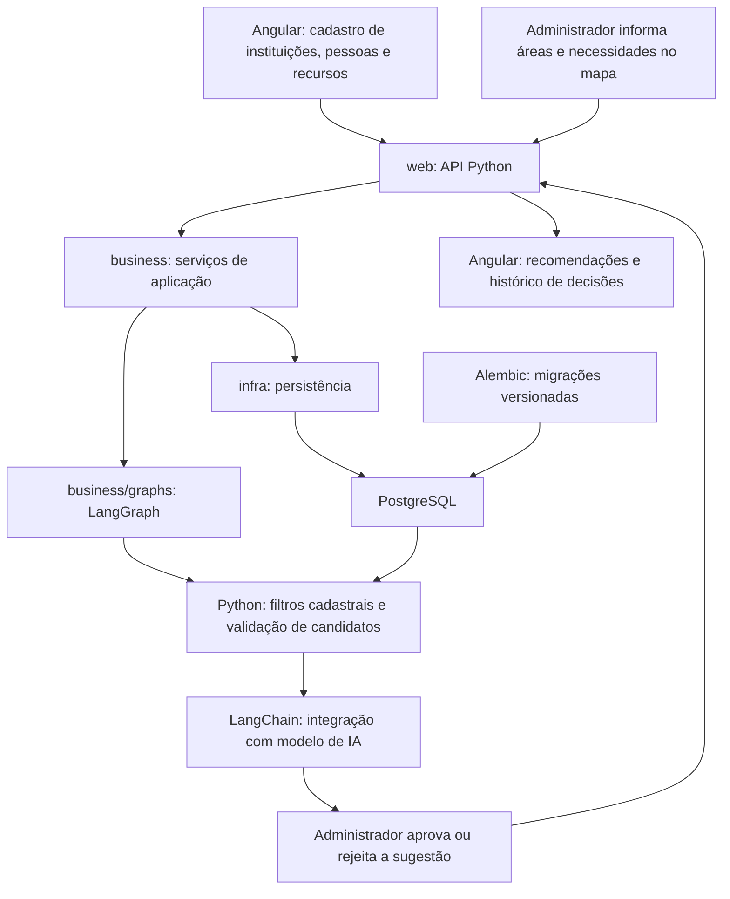

# RedeSolidária

Proposta acadêmica de plataforma para cadastrar instituições, voluntários e recursos e apoiar a organização de equipes em localidades afetadas por desastres.

**Protótipo navegável de todas as telas:** disponível em [prototipo/](prototipo/README.md), com Angular, dados fictícios em memória, mapa esquemático, demandas, sugestões simuladas e decisões. Abrir [localhost:4300](http://127.0.0.1:4300) com `npm start` nessa pasta. Cobre as 29 tabelas iniciais e 21 futuras, estas identificadas como rascunhos. [Instruções para a IA de estilização](prototipo/ESTILIZACAO.md).

**Estado da aplicação integrada:** sexto incremento implementado, com as **29 tabelas iniciais**, API Python/PostgreSQL, migrações Alembic e Angular. O fluxo área → demanda → recuperação → recomendação → decisão está integrado com LangChain/LangGraph. A verificação utilizou provedor HTTP fictício; modelos reais e indicador acadêmico ainda precisam ser avaliados. Ver [estado da implementação](docs/implementacao-inicial.md) e [contratos de IA e demandas](docs/ia-demandas-recomendacoes.md).

**Interface da aplicação integrada:** visual do protótipo aplicado ao Angular em `frontend/`, com tema claro azul, menu lateral, formulários e recomendações responsivos. Executar `npm start` nessa pasta e abrir [localhost:4200](http://127.0.0.1:4200). A aplicação utiliza a API e o banco; o projeto independente em `prototipo/` continua na porta 4300.

Para executar: seguir [backend/README.md](backend/README.md). A configuração editável está em [backend/project.toml](backend/project.toml); dependências fixas e locks estão disponíveis para backend e frontend.

**Specs de intenção das telas e Testes de Interface:** [specs/README.md](specs/README.md) reúne ações de cada controle, resultados esperados e cenários de teste de interface com Playwright.
Para executar os testes automatizados da aplicação:
```powershell
testar-ui              # Executa toda a suíte de testes
testar-ui pessoas      # Executa apenas a funcionalidade 'pessoas'
testar-ui instituicoes # Executa apenas a funcionalidade 'instituicoes'
testar-ui --headed     # Executa com o navegador visível
```
As credenciais administrativas e a URL alvo são configuradas no arquivo [`.env-teste`](.env-teste) na raiz do projeto.

## Escopo da primeira entrega

A primeira entrega integrada será de **apoio à decisão**: cadastrar capacidades, registrar áreas e demandas no mapa e gerar sugestões por IA para análise do administrador. O protótipo navegável demonstra esse percurso com sugestões simuladas. O [escopo inicial](docs/escopo-inicial.md) registra as tabelas, telas e critérios de conclusão, conforme D009.

**Fluxo:** área afetada → demanda → busca de capacidades → recomendação da IA → aprovação ou rejeição administrativa.

A demonstração utilizará uma ocorrência fictícia, em um município, com três áreas afetadas. A aprovação registra a decisão sobre a sugestão; não cria missão, não reserva recursos/pessoas e não conta como entrega.

A busca semântica começa pelo catálogo de atividades. Os demais cadastros serão relacionados por filtros estruturados; seus índices semânticos permanecem previstos para evolução. Agenda, reservas, missões, movimentações de estoque, entregas e rotas ficam fora da primeira entrega. A gestão administrativa de modelos foi implementada no incremento 6; cada análise preserva os IDs capturados, sem troca automática dentro da execução. As tabelas restantes estão preservadas no [inventário operacional](docs/modelo-operacional-proposto.md).

O [controle de tarefas](docs/controle-tarefas.md) reúne tarefas gerais e as 50 tabelas do inventário, com etapa, estado e motivo de negócio: 29 iniciais e 21 futuras. O pacote de [simulação do escopo inicial](simulacoes/escopo_inicial/README.md) complementa o entendimento para pessoas e outras IAs.

## Objetivo e meta do PN-PDC

- **Diretriz 3:** Gestão de desastres para o fortalecimento das ações de resposta aos desastres e da recuperação de áreas afetadas, com ênfase em reconstruir melhor e na adoção de infraestruturas resilientes.
- **Objetivo 3.1:** Aprimorar as capacidades de atuação na resposta a desastres.
- **Meta 3.1.3:** Criar cadastro nacional de voluntários institucionais para formar rede para atuar na resposta a desastres.
- **Eixo de atuação:** Resposta.
- **Prazo:** 2031.
- **Indicador oficial:** Cadastro nacional criado.
- **Responsável oficial:** Secretaria Nacional de Proteção e Defesa Civil (Sedec), Ministério da Integração e do Desenvolvimento Regional (MIDR).
- **Referência:** PN-PDC 2025–2035, Quadro 6, páginas impressas 114–115 (página 58 do PDF).

O projeto contribui para essa meta por meio de um cadastro estruturado e de ferramentas de apoio à mobilização. O protótipo local não representa a criação do cadastro nacional nem o cumprimento integral da meta. Para manter aderência ao termo “institucionais”, haverá cadastro de instituições e vínculo dos voluntários com elas. Pessoas sem vínculo poderão ser contempladas como ampliação do escopo.

## Solução computacional

### Problema e público

Hipótese a validar: informações dispersas sobre voluntários, qualificações, disponibilidade e recursos dificultam a formação de equipes adequadas durante desastres.

Público previsto: agentes de Defesa Civil, administradores da operação, instituições parceiras, voluntários e comunidades afetadas.

**Pendente:** escolher município ou comunidade, caracterizar o desastre e reunir evidências locais do problema.

### Funcionalidades da primeira entrega

1. Cadastrar instituições e pessoas, incluindo profissões, cursos técnicos, comprovações, localização, atividades e ofertas.
2. Permitir ao administrador validar os dados cadastrais e registrar a situação das qualificações.
3. Cadastrar recursos materiais, veículos e equipamentos, com quantidade, localização e instituição responsável.
4. Apresentar um mapa da localidade afetada, permitindo ao administrador desenhar áreas e informar gravidade, necessidades e horário da atualização.
5. Utilizar IA para sugerir pessoas, instituições e recursos conforme as necessidades, dados cadastrados e critérios estruturados implementados, explicando cada recomendação e suas pendências.
6. Na primeira entrega, permitir ao administrador aprovar ou rejeitar recomendações e consultar seu histórico. Alocações e acompanhamento de missões ficam para evolução futura.

### Entrada, processamento e saída

| Etapa | Descrição |
|---|---|
| Entrada | Cadastros de instituições, pessoas, profissões, cursos, atividades, ofertas e recursos; áreas afetadas e demandas informadas pelo administrador. |
| Processamento | Validação dos dados; busca semântica de atividades; consultas e filtros estruturados; sugestão de pessoas, instituições e recursos por IA, com validação dos IDs e critérios implementados. |
| Saída | Mapa de áreas afetadas, sugestões justificadas de pessoas/instituições/recursos e histórico de decisões administrativas. Alocações e painel de missões ficam para evolução futura. |

**Pendente:** detalhar perfis/login de produção, requisitos de qualificação e tratamento de dados pessoais. Campos obrigatórios e escala inicial de prioridade já são validados pela API.

## Arquitetura

Arquitetura implementada para o escopo de apoio à decisão, incluindo demandas, recuperação semântica, recomendações e histórico:



As regras da primeira entrega validam referências, dados cadastrais e critérios estruturados implementados. A IA apoia a decisão; o administrador analisa a sugestão e suas pendências. Verificação de agenda, reserva e atualização transacional de disponibilidade serão necessárias na evolução para alocações e missões.

O backend utiliza Python, o frontend Angular e a persistência PostgreSQL. LangGraph organiza recuperação, sugestão e validação em `business/graphs`; LangChain integra embeddings e inferência de texto. O administrador avalia o resultado e registra decisão. O mapa usa Leaflet 1.9.4/OpenStreetMap, com polígono GeoJSON tipado em JSONB. Contratos e limites em [D014–D017](docs/decisoes-modelagem.md).

### Padrão da skill adaptado para Python

Referência: [dotnet-api-skill-cc](C:/Git/skills/dotnet-api-skill-cc/SKILL.md). A arquitetura de quatro projetos da skill será convertida em quatro pastas/pacotes Python, mantendo a direção de dependências **web → business → infra → core**. O frontend Angular será um projeto separado. Comandos, pacotes e arquivos específicos de .NET serão substituídos por equivalentes Python.

Estrutura de referência: as quatro camadas, primeiro CRUD, migrações, scripts e projeto Angular já existem. Subdivisões adicionais serão criadas conforme necessário:

```text
backend/
  project.toml
  pyproject.toml              # Gerado a partir de project.toml
  uv.lock
  core/
    __init__.py
    entity/                   # Entidades de domínio e classe base
    http/                     # Envelope de sucesso, mensagens e erros tipados
  infra/
    __init__.py
    database/                 # Conexão, sessão e persistência
    configurations/           # Mapeamentos das entidades para PostgreSQL
    migrations/               # Ambiente e revisões Alembic
  business/
    __init__.py
    servico/                  # Contratos e implementação dos serviços
    view_models/              # Modelos de entrada e saída
    validators/               # Validação de entrada e regras
    graphs/                   # Processamento de IA separado
      __init__.py
      states/                 # Estados e atualizações tipados do grafo
      nodes/                  # Etapas de consulta, recomendação e validação
      tools/                  # Ferramentas tipadas de acesso autorizado
  web/
    __init__.py
    controllers/              # Rotas e tradução HTTP
    filters/                  # Validação transversal
    middlewares/              # Tratamento global de erros e logs
    autenticacao/             # Validação JWT e autorização por perfil
    main.py                   # Inicialização e composição de dependências
  tests/
  alembic.ini
frontend/                     # Projeto Angular
  src/app/
    core/                     # Serviços HTTP, autenticação e interceptadores
    shared/                   # Componentes e contratos compartilhados
    features/                 # Cadastros, mapa, demandas, recomendações e histórico
```

A organização foi iniciada em código, com subdivisões futuras indicadas na referência. `core` não importa camadas superiores; isso é verificado nos testes. Controllers delegam operações a serviços de `business`, sem SQL ou processamento de IA diretamente nas rotas. Integrações de IA que precisem de acesso a dados utilizarão serviços de persistência de `infra`.

### Contratos e convenções

- Todas as classes, atributos, funções, parâmetros e retornos terão tipos explícitos.
- Dicionários com estrutura conhecida serão representados por `TypedDict` ou modelos tipados; mapas de chaves variáveis terão tipos explícitos de chave e valor, por exemplo `dict[str, int]`. Não utilizar `dict` genérico ou `Any` como contrato de negócio.
- Entidades, entradas, saídas, estados do LangGraph, atualizações dos nós e argumentos/resultados das ferramentas de IA terão contratos tipados. Dados externos serão validados na entrada; anotações de tipo isoladas não substituem essa validação.
- O frontend Angular utilizará interfaces/tipos explícitos e verificação estrita de TypeScript e templates.
- Sucesso HTTP seguirá o envelope da skill: `{ "data": ..., "messages"?: [...] }`, omitindo `messages` quando não houver mensagens. Mensagens terão `severity`, `code` e `text`.
- Erros HTTP seguirão ProblemDetails (RFC 9457), sem envelope de sucesso, incluindo falhas de validação, autenticação, autorização e erros inesperados.
- A inicialização centralizará a composição de dependências, CORS com origens configuradas, tratamento global de erros, logs e documentação OpenAPI.
- JWT e autorização por perfil serão adaptados à API Python. O mecanismo de login/emissão de tokens ainda será definido; o exemplo de login Google mobile da skill não é um requisito do frontend Angular.
- Alterações de banco serão feitas por migrações Alembic versionadas em `infra/migrations`, com revisão antes de aplicação. Migrações automáticas na inicialização ficarão desabilitadas por padrão.
- A verificação estática é estrita, com mypy 2.4.0; Ruff 0.16.10 verifica estilo/imports. Versões constam no manifesto e no lock.

### Processamento de IA em business/graphs

O fluxo implementado usa estados tipados para recuperação, sugestão e validação. Consulta atividades semanticamente e seleciona ofertas/recursos por relações e filtros estruturados. A saída do LLM é validada quanto a IDs, relações e quantidades; mudanças no contexto durante a análise impedem publicação. Agenda, requisitos avançados e capacidade por período permanecem futuros.

O grafo produz sugestões de pessoas, instituições e recursos, com justificativas e pendências. Aprovação/rejeição é persistida com data, sujeito administrativo e justificativa; nova análise preserva a anterior. Aprovação não altera pedido ou estoque nem cria alocação. Regras e sequência de configuração em [IA, demandas e recomendações](docs/ia-demandas-recomendacoes.md).

## Modelo inicial de entidades

O mapeamento lógico está em [Modelo de entidades](docs/modelo-entidades.md), com campos tipados, relacionamentos e diagrama ER. As **29 tabelas iniciais** têm entidades, mapeamentos e migrações, com funcionalidades integradas na API e no Angular. As 21 futuras permanecem no [controle de tarefas](docs/controle-tarefas.md).

| Entidade / grupo | Papel |
|---|---|
| Instituições | Organizações participantes da rede. |
| Pessoas e vínculos institucionais | Voluntários e sua participação nas organizações. |
| Profissões, cursos e qualificações individuais | Formação e comprovações verificáveis de cada pessoa. |
| Tipos de recurso e recursos | Bens físicos e estoques, com responsável e controle por unidade. |
| Categorias e atividades | Catálogo do que pode ser realizado ou provido. |
| Ofertas de atividades | Relação entre uma atividade e uma pessoa ou instituição, com capacidade e condições. |
| Oferta de atividade e recurso | Bens previstos para executar uma oferta, sem reserva automática. |
| Conexão de IA | Provedor, URL base, autenticação e token criptografado, com chave externa. |
| Modelo de IA | Cadastro comum para embeddings e inferência de texto, com conexão, finalidade e seleção ativa. |
| Índices semânticos dos catálogos | Tabelas específicas para atividades, profissões, cursos e tipos de recurso, com embedding, hash de origem e metadados. |
| Tipos de desastre e classificações | Catálogo relacionado N:N às ocorrências, com um tipo principal por desastre. |
| Desastres | Ocorrências com período, situação operacional e instituição coordenadora. |
| Áreas afetadas | Recortes territoriais da ocorrência, com município, geometria, gravidade e última avaliação. |
| Demandas e itens | Pedidos de atendimento por área, com prioridade, prazo e necessidades mensuráveis de atividade ou tipo de recurso. |
| Unidades de medida | Catálogo compartilhado por itens de demanda, tipos de recurso e capacidades de atividades. |
| Recomendações e candidatos | Sugestões por IA, com itens, pessoas, instituições/ofertas, recursos, justificativas e histórico administrativo. |

A atividade descreve **o que se faz**; a oferta descreve **quem pode fazer/prover**. O conteúdo descritivo e seu hash atual ficam em `atividades`; o índice guarda o embedding e o hash da origem, sem duplicar o texto. Alterações invalidam o índice, e o hash é revalidado atomicamente antes da publicação do embedding. As decisões estão em [Decisões de modelagem](docs/decisoes-modelagem.md).

A decisão D006 estende esse padrão a `profissoes`, `cursos` e `tipos_recurso`, com `hash_conteudo_semantico` no catálogo e tabelas `profissao_indice_semantico`, `curso_indice_semantico` e `tipo_recurso_indice_semantico`. Cada índice preserva FK real para a entidade e unicidade no par entidade/modelo. A busca de recursos encontra primeiro o tipo e depois consulta bens/estoques por filtros estruturados; embeddings de recursos individuais ficam para uma extensão futura. Similaridade não comprova qualificação, equivalência de cursos ou compatibilidade técnica.

`modelo_ia` atende a `embedding` e `inferencia_texto`, com no máximo um selecionado por finalidade. Conexão/token cifrado ficam em `conexao_ia`, com chave externa; índices referenciam `id_modelo`. Ativação de embeddings exige 100% de cobertura atual das atividades ativas, único catálogo habilitado em D009. Identidade do modelo é imutável; outra dimensão/revisão exige novo cadastro. Cada execução captura os modelos; trocar somente o LLM não exige reindexação.

O armazenamento inicial dos embeddings usa `double precision[]`, com dimensão validada pelo modelo e trigger SQL. Busca por cosseno exato em Python, limitada explicitamente a 5000 vetores atuais. Pgvector/ANN permanece uma evolução para escala; nenhuma extensão vetorial foi instalada. Similaridade não comprova qualificação, capacidade ou disponibilidade.

A decisão D007 define `desastres`, `tipos_desastre`, `desastre_tipo` e `areas_afetadas`, implementados conforme D014. Uma ocorrência pode ter vários tipos, com exatamente um principal, e atingir vários municípios por suas áreas. O administrador desenha as áreas no mapa e informa gravidade e situação; a data da avaliação é separada da edição cadastral. Demandas são vinculadas à área, com prioridade própria, e alimentam recomendações; missões ficam para evolução futura. Encerramento operacional preserva o histórico e é distinto da inativação cadastral.

A decisão D008 define `demandas`, `demanda_itens` e `unidades_medida`. Cada item solicita uma atividade ou um tipo de recurso, com quantidade positiva e unidade compatível. A pessoa solicitante é separada do usuário que registra. Atendimento parcial será calculado a partir de registros confirmados, sem tratar recomendação ou reserva como entrega. Requisitos, missões, reservas e demais tabelas operacionais estão sugeridos em [Modelo operacional proposto](docs/modelo-operacional-proposto.md), para discussão.

A decisão D009 delimita a primeira entrega. `recomendacoes`, `recomendacao_itens`, `recomendacao_pessoas`, `recomendacao_instituicoes` e `recomendacao_recursos` entram nesse protótipo; as demais tabelas operacionais são evolução futura. A modelagem completa dos quatro índices semânticos permanece válida, com somente atividades habilitadas para busca vetorial nesta etapa.

**Pendente:** escolher/configurar modelos reais, avaliar pertinência e medir o indicador; definir login de produção e hospedagem. Requisitos, capacidade por período, disponibilidade, reservas, missões, atendimentos e evolução geográfica permanecem futuros.

## Tecnologias

A stack é **Python 3.13, FastAPI, SQLAlchemy/psycopg, LangChain, LangGraph, PostgreSQL, Alembic, Angular e Leaflet**. O mapa inicial usa OpenStreetMap. Modelos/provedores reais de IA ainda não foram escolhidos. Versões exatas estão nos manifestos e locks; integração técnica pronta, avaliação com provedor real pendente.

| Componente | Função na solução | Situação |
|---|---|---|
| Angular | Oferecer cadastros, mapa, demandas, recomendações e histórico administrativo em um projeto frontend separado. | Framework 21.2.25; CLI/build 21.2.26; telas integradas de todo o escopo inicial. |
| Python 3.13 | Desenvolver o backend, validações, consultas e serviços de recomendação. | `requires-python = ">=3.13,<3.14"`; FastAPI 0.143.0, SQLAlchemy 2.1.4 e psycopg 3.3.6. |
| PostgreSQL | Armazenar instituições, pessoas, qualificações, capacidades, recursos, áreas, demandas e recomendações. | 18.3 fixado por digest para ambiente local; 29 tabelas migradas/testadas. Geometria tipada em JSONB, sem PostGIS. |
| Mapa interativo | Exibir a localidade e permitir desenho manual de áreas afetadas. | Leaflet 1.9.4, tipos 1.9.22 e OpenStreetMap; polígonos simples, gravidade e avaliação. Sem rotas, geocodificação ou análise espacial. |
| LangChain | Integrar o modelo de IA e as ferramentas de consulta para apoiar recomendações justificadas. | 1.4.4; embeddings e texto integrados, verificados com HTTP fictício; provedor real pendente. |
| LangGraph | Organizar o fluxo de consulta, validação e recomendação e sua passagem para aprovação administrativa. | 1.2.14; recuperação, sugestão, validação e persistência integradas/testadas. |
| Alembic | Versionar e aplicar migrações do banco PostgreSQL. | 1.20.0; revisões 0001–0009, incluindo IA, demandas, índices e recomendações. |
| Análise de dados / dashboard | Apresentar necessidades e capacidades cadastradas; acompanhamento de missões na evolução futura. | Proposta; implementação pendente. |

### Configuração e versões

- O arquivo de configuração solicitado para o backend é **`project.toml`**.
- A restrição do interpretador será exatamente `requires-python = ">=3.13,<3.14"`.
- Todas as demais dependências Python, inclusive de desenvolvimento e build, terão versões exatas com `==`. As dependências Angular terão versões exatas em `package.json`, sem `^`, `~`, curingas ou `latest`.
- Dependências transitivas estão fixadas em `backend/uv.lock` e `frontend/package-lock.json`. A instalação e os testes do primeiro incremento foram executados com essas versões.
- **Compatibilidade do nome:** `backend/project.toml` é a origem editável; `scripts/sync_manifest.py` gera `pyproject.toml` para uv/build e possui opção `--check`. O arquivo gerado é ignorado pelo Git. Referência do formato padrão: [Python Packaging User Guide](https://packaging.python.org/en/latest/guides/writing-pyproject-toml/).

## Protótipo

**Situação da aplicação integrada:** API e Angular cobrem as **29 tabelas iniciais** e o fluxo área → demanda → recomendação → decisão. Passaram 103 testes com PostgreSQL, migrações, mypy/Ruff, build/typecheck Angular e 17 cenários de navegador. A IA foi exercitada via LangChain/LangGraph contra HTTP fictício local; tiles do mapa também são simulados no teste. Provedor real, qualidade semântica e indicador não foram validados. Instruções em [Estado da implementação](docs/implementacao-inicial.md).

Escopo inicial registrado: uma ocorrência fictícia em um município, dados fictícios de instituições e voluntários e três áreas afetadas. Ver [Escopo inicial](docs/escopo-inicial.md).

Telas previstas:

1. Cadastro e consulta de instituições e voluntários, com profissões e cursos técnicos.
2. Cadastro de recursos, atividades e ofertas, sem agenda/reservas.
3. Mapa com marcação administrativa das áreas, gravidade e cadastro de demandas/itens.
4. Recomendações de pessoas, instituições e recursos com justificativa e aprovação/rejeição.
5. Histórico de recomendações e decisões administrativas.

Cenário de demonstração: o administrador marca uma área inundada, registra demanda e itens, solicita uma recomendação, analisa candidatos/recursos/pendências e aprova ou rejeita a sugestão. Não há despacho de equipe ou entrega de recurso nesta etapa.

**Pendente:** escolher localidade, preparar a demonstração acadêmica, configurar modelos reais e medir pertinência/tempo. O protótipo independente continua disponível para a IA responsável pela estilização.

## Validação do modelo por simulação em memória

O exercício foi atualizado para D008/D009 e está organizado em [simulacoes/escopo_inicial](simulacoes/escopo_inicial/README.md), com contexto para outra IA, dataclasses tipadas, dados fictícios, script reproduzível e resultados Markdown/JSON. Usa Python 3.13.12 e somente biblioteca padrão; o estado de negócio permanece em memória e somente os artefatos de resultado são gravados.

O [relatório atual](simulacoes/escopo_inicial/resultados/relatorio.md) registra **54 verificações OK, zero falhas e oito limites documentados**. Foram exercitados itens/unidades de demanda, referências das sugestões, rejeição de IDs inexistentes, aprovação/rejeição, nova análise com histórico, preservação de estoque/pedidos, modelos, hashes e dimensões. Rejeições esperadas contam como verificações OK; limites não contam como testes aprovados.

O cenário combina inundação/deslizamento, um município fictício, três áreas, três demandas e seis itens. As sugestões independentes de água somam 400 L para 300 L cadastrados: déficit de 100 L, explicitado sem prometer um plano reservado. Caminhão/João aparecem em duas janelas sobrepostas; cozinha/Paula não têm suas capacidades somadas como cobertura comprovada; energia fica sem recurso sugerido pelo adaptador do cenário.

As classes são recortes auxiliares, e as respostas/vetores são artificiais. Banco, transações, segurança, mapa, LLM/RAG real e eficácia operacional não foram testados. Convenções do exercício não aprovam contratos pendentes. O indicador de redução de tempo continua sem medição.

Reprodução, a partir da raiz e com Python >=3.13,<3.14: `python simulacoes/escopo_inicial/simular_desastre.py --salvar`. O [primeiro exercício](docs/simulacao-desastre.md), anterior a D008/D009 e com dois municípios, foi preservado como histórico.

## Indicador

### Indicador oficial da meta

**Cadastro nacional criado.** Este indicador pertence ao PN-PDC e não deve ser confundido com o desempenho do protótipo acadêmico.

### Indicador de resultado da solução

**Proposta para a primeira entrega:** reduzir em 50% o tempo para identificar candidatos pertinentes a uma demanda em cenários fictícios, comparando consulta manual e consulta assistida pela plataforma.

- **Início da medição:** apresentação das necessidades da área.
- **Fim da medição:** identificação de candidatos que atendam aos critérios cadastrais e estruturados definidos para o cenário, com pendências explicitadas.
- **Cálculo:** redução (%) = ((tempo médio manual − tempo médio assistido) / tempo médio manual) × 100.
- **Método proposto:** utilizar cenários equivalentes, com o mesmo conjunto de pessoas, ofertas, recursos e critérios, e registrar tempo e pertinência dos candidatos.
- **Verificação complementar:** percentual de sugestões pertinentes que respeitam os critérios estruturados e referenciam cadastros existentes; sugestões inválidas não contam como sucesso por serem mais rápidas. Não medir aptidão operacional ou disponibilidade de agenda ainda não implementadas.

**Situação:** indicador e alvo propostos, ainda sem testes ou resultados. A redução de 50% não é um benefício comprovado.

**Pendente:** definir quantidade de cenários e participantes, medir a linha de base, executar a comparação e registrar os resultados.

## Benefício esperado e limitações

Benefício esperado: facilitar a consulta de capacidades disponíveis e reduzir o esforço de organização de equipes para atendimento às áreas afetadas.

Limitações e riscos: cadastros desatualizados, qualificações não verificadas, indisponibilidade de conexão, informações incompletas no mapa e recomendações inadequadas. A primeira entrega prevê validação cadastral e avaliação humana; confirmação de disponibilidade e reservas exigem a evolução operacional. A proximidade geográfica, sozinha, não comprova acesso seguro à área.

## Pacote de Entrega e Sistematização

Os artefatos consolidados exigidos pelo edital de Sistematização (Seções 10, 11 e 12) estão organizados na pasta [`entrega/`](entrega/README.md):

- **Documento Principal:** [`Entrega_Sistematizacao_RedeSolidaria.pdf`](entrega/Entrega_Sistematizacao_RedeSolidaria.pdf) e versão Word [`Entrega_Sistematizacao_RedeSolidaria.docx`](entrega/Entrega_Sistematizacao_RedeSolidaria.docx) (19 páginas, estruturado conforme o padrão visual e tipográfico do CEUB).
- **Roteiro do Pitch de 5 Minutos:** [`ROTEIRO_PITCH_5_MINUTOS.md`](entrega/ROTEIRO_PITCH_5_MINUTOS.md) e [`ROTEIRO_PITCH_5_MINUTOS.pdf`](entrega/ROTEIRO_PITCH_5_MINUTOS.pdf) (cronometrado de 00:00 a 05:00 com resposta às 5 perguntas obrigatórias).
- **Apresentação de Slides:** [`SLIDES_APRESENTACAO_PITCH.html`](entrega/SLIDES_APRESENTACAO_PITCH.html) e [`SLIDES_APRESENTACAO_PITCH.pdf`](entrega/SLIDES_APRESENTACAO_PITCH.pdf) (8 slides executivos).
- **Pacote Unificado:** [`Entrega_Sistematizacao_Luis_Roberto_Moraes.zip`](entrega/Entrega_Sistematizacao_Luis_Roberto_Moraes.zip) contendo todos os artefatos.
- **Integrante:** Luis Roberto de Moraes (CEUB).
- **Meta PN-PDC 2025–2035:** Meta 3.1.3 — Cadastro nacional de voluntários institucionais (Eixo Resposta, prazo 2031).
- **Indicador da Solução:** Redução de pelo menos 50% no tempo médio de triagem com validação determinística de 100% dos IDs cadastrais (54 testes OK sem falhas).

## Documentos de referência


- [Ferramenta de testes de interface, guias e modelos](testes/README.md).
- [Plano Nacional de Proteção e Defesa Civil](PLANO-NACIONAL-DE-PROTECAO-E-DEFESA-CIVIL.pdf).
- [Enunciado da sistematização](Sistematiza%C3%A7%C3%A3o.pdf).
