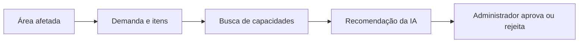

# Escopo inicial — protótipo de apoio à decisão

**Estado: registrado a pedido do usuário.** Este documento define a primeira entrega. O modelo completo e as decisões D001–D008 permanecem documentados; tabelas e funcionalidades futuras não precisam ser implementadas nesta etapa.

## Objetivo e fluxo

Cadastrar capacidades, registrar necessidades no mapa e gerar sugestões de atendimento por IA para análise administrativa.

A aprovação registra a decisão sobre a sugestão. Não cria missão, reserva de recursos, alocação de pessoas ou registro de entrega nesta versão. O saldo da demanda não é reduzido por uma aprovação.

## Cenário de demonstração

- Uma ocorrência fictícia, em um município, com três áreas afetadas.
- Instituições, pessoas, profissões, cursos, atividades e recursos fictícios.
- O administrador delimita áreas no mapa, informa gravidade e cadastra demandas com itens, quantidades e prioridade.
- A IA consulta dados cadastrados, sugere candidatos e recursos e explica escolhas, limitações e necessidades sem candidato.
- O administrador aprova ou rejeita a sugestão, mantendo o histórico. Nova análise gera outra recomendação, sem apagar a anterior.

Uma ocorrência e um município delimitam os dados da demonstração, não alteram a modelagem que permite múltiplas ocorrências, classificações e municípios.

## Dentro da primeira entrega

| Parte | Limite de implementação |
|---|---|
| Cadastros | Instituições, pessoas, vínculos, profissões, cursos, atividades, ofertas e recursos. Catálogos auxiliares podem ser previamente carregados; não é obrigatório construir um CRUD completo para cada tabela. |
| Qualificações | Registrar profissões/cursos e validação cadastral; apresentar essas informações na análise de candidatos, sem afirmar aptidão operacional além dos critérios efetivamente verificados. |
| Desastre e mapa | Registrar ocorrência, classificações e três áreas com delimitação, gravidade e situação. |
| Demandas | Cabeçalho por área e itens de atividade ou tipo de recurso, com quantidade positiva, unidade compatível, prioridade e prazo. |
| Recuperação | Busca semântica inicialmente pelo catálogo de atividades; relacionar ofertas, pessoas, qualificações e recursos por filtros estruturados. |
| IA | LangGraph organiza o fluxo; LangChain integra o modelo; produzir saída tipada com IDs existentes e justificativas. |
| Recomendações | Persistir sugestão, itens, pessoas, instituições/ofertas e recursos, identificando modelos utilizados e histórico de decisão administrativa. |
| Análise administrativa | Aprovar ou rejeitar a recomendação; registrar responsável pela decisão conforme o modelo de usuários a definir. |
| Modelos/conexões | Preservar a estrutura normalizada de modelos, conexão e credencial protegida. Gestão administrativa implementada em D015; cada análise captura modelos e não mistura IDs durante a execução. |

O protótipo identifica candidatos e capacidades declaradas. Não comprova disponibilidade por horário nem capacidade adicional de ofertas que compartilham pessoas ou bens. Informar as pendências na recomendação; não apresentar sugestões como alocações garantidas.

## Tabelas da primeira entrega

Os nomes e campos do cadastro estão no [modelo de entidades](modelo-entidades.md). Os contratos de recomendações estão no [modelo operacional](modelo-operacional-proposto.md), marcados para esta etapa.

| Grupo | Tabelas |
|---|---|
| Instituições e pessoas | `instituicoes`, `pessoas`, `pessoa_instituicao` |
| Qualificações | `profissoes`, `pessoa_profissao`, `cursos`, `pessoa_curso` |
| Capacidades e bens | `categorias_atividade`, `atividades`, `atividade_termos`, `ofertas_atividade`, `oferta_atividade_recurso`, `tipos_recurso`, `recursos`, `unidades_medida` |
| Ocorrência e território | `tipos_desastre`, `desastres`, `desastre_tipo`, `areas_afetadas` |
| Pedidos | `demandas`, `demanda_itens` |
| IA e recuperação inicial | `conexao_ia`, `modelo_ia`, `atividade_indice_semantico` |
| Sugestões e decisões | `recomendacoes`, `recomendacao_itens`, `recomendacao_pessoas`, `recomendacao_instituicoes`, `recomendacao_recursos` |

As **29 tabelas iniciais** estão implementadas até o incremento 6, com API, migrações e Angular, incluindo conexões/modelos, demandas, recuperação e recomendações. [Estado e evidências](implementacao-inicial.md). Estoque continua como quantidade cadastrada, sem reservas/movimentações. Provedor real, demonstração acadêmica e indicador permanecem pendentes; implementação das tabelas não conclui sozinha a entrega acadêmica.

## Evolução futura

- Índices semânticos de profissões, cursos e tipos de recurso, preservando a decisão D006. Até essa etapa, somente atividades estarão habilitadas para busca vetorial; cobertura do modelo é verificada nos catálogos habilitados.
- Requisitos avançados de cursos/profissões e características técnicas de recursos.
- Composição detalhada de ofertas, capacidades compartilhadas e capacidade por período.
- Agenda, disponibilidade por horário, aceite de voluntários e alocações concorrentes.
- Missões, reservas de recursos e acompanhamento de execução.
- Movimentações de estoque, entregas, atendimento parcial e correções.
- Rotas, condições de acesso e avaliações espaciais mais completas.
- Troca automática de modelos dentro da execução, keyring/rotação completa de chaves e indexação vetorial para escala. Gestão administrativa de conexões/modelos já implementada em D015.

As tabelas propostas para essa evolução estão inventariadas no [modelo operacional](modelo-operacional-proposto.md). A existência do inventário não aprova automaticamente seus campos, estados e regras finais.

## Telas da demonstração

1. Cadastro/consulta de instituições, pessoas, qualificações, ofertas e recursos.
2. Mapa da ocorrência, com cadastro e avaliação das áreas afetadas.
3. Cadastro e consulta das demandas e seus itens.
4. Resultado da recomendação, com pessoas, instituições, recursos e justificativas.
5. Histórico de recomendações e decisões do administrador.

## Indicador e critérios de conclusão

Indicador proposto: tempo para identificar candidatos pertinentes a uma demanda, comparando consulta manual e assistida nos mesmos cenários fictícios. A redução de 50% permanece um alvo a avaliar, não um resultado comprovado. Medir também pertinência e respeito aos critérios estruturados; respostas rápidas com candidatos inválidos não contam como melhoria.

Concluir a primeira entrega quando o fluxo de área → demanda → recomendação → decisão administrativa puder ser demonstrado e persistido, a saída da IA referenciar registros existentes, o histórico for preservado e o resultado do indicador estiver registrado. Não exigir execução de missões ou entrega de recursos para concluir esta etapa.

## Pendências técnicas desta etapa

Stack, mapa, 29 tabelas e fluxo integrado estão implementados conforme D010–D017, mantendo Python 3.13, LangChain, LangGraph, PostgreSQL, Alembic e Angular. Vetores em arrays PostgreSQL, busca exata até 5000, cobertura integral de atividades antes da ativação e credenciais cifradas. Faltam escolher/configurar modelos reais, avaliar qualidade, preparar demonstração, medir indicador e definir login/usuários/perfis de produção. Rotas/análise espacial e operação ficam futuros. [Contratos e configuração](ia-demandas-recomendacoes.md).