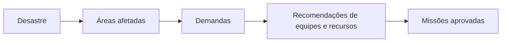

# RedeSolidária — modelo inicial de entidades

Estado: modelo lógico do MVP, com **29 tabelas iniciais implementadas** até o incremento 6. Entidades, migrações, API e Angular incluem conexões/modelos, demandas, índice de atividades e recomendações/decisões. Ver [estado da implementação](implementacao-inicial.md) e [contratos do incremento 6](ia-demandas-recomendacoes.md). As 21 tabelas futuras continuam no [controle de tarefas](controle-tarefas.md). A [simulação em memória](../simulacoes/escopo_inicial/README.md) é um exercício separado, sem aprovar contratos adicionais.

O [escopo inicial](escopo-inicial.md), registrado em D009, define quais partes entram no primeiro protótipo de apoio à decisão. Índices semânticos adicionais e execução operacional permanecem no planejamento de evolução, preservando as decisões anteriores.

## Conceitos

| Conceito | Representa | Exemplo |
|---|---|---|
| Instituição | Organização que participa da rede. | Associação comunitária. |
| Pessoa | Indivíduo com qualificações e vínculos institucionais opcionais. | Voluntária com formação técnica em enfermagem. |
| Recurso | Bem físico ou estoque que pode ser disponibilizado. | Caminhonete, gerador ou lote de água potável. |
| Atividade | Tipo de serviço ou capacidade do catálogo, independente de quem oferece. | Transporte de suprimentos ou preparo de refeições. |
| Oferta de atividade | Declaração de que uma pessoa ou instituição pode realizar uma atividade, com limites e condições. | Associação oferece preparo de 200 refeições por dia. |
| Tipo de desastre | Classificação do fenômeno associado à ocorrência. | Inundação ou deslizamento. |
| Desastre | Ocorrência concreta que organiza a operação de atendimento. | Inundação em Município X — outubro de 2026. |
| Área afetada | Recorte territorial atingido dentro de uma ocorrência. | Bairro delimitado pelo administrador no mapa. |
| Demanda | Pedido de atendimento de uma área, com prioridade e prazo. | Atender famílias da Várzea até as 14h. |
| Item de demanda | Necessidade mensurável de uma atividade ou tipo de recurso. | Fornecer 200 litros de água. |

Uma pessoa pode oferecer várias atividades e ter vínculo com várias instituições. Uma instituição pode oferecer várias atividades e possuir vários recursos. Profissão, curso, atividade e recurso são conceitos separados: possuir uma caminhonete não comprova capacidade para dirigir e ter um curso não comprova disponibilidade para uma missão.

## Convenções de tipos e auditoria

Tabelas em português com `snake_case`, identificadores `UUID` e datas com fuso horário. O incremento 1 usa UUID v4 gerado pela aplicação e timestamps UTC. Campos opcionais são anuláveis no banco e nos tipos Python.

Todas as entidades e associações terão `id: UUID`, `criado_em: datetime`, `atualizado_em: datetime` e `inativado_em: datetime | None`. A inativação preserva o registro; inativos são excluídos da seleção operacional. As 29 tabelas implementadas incluem `criado_por: str` e `atualizado_por: str`, com o `sub` do JWT validado pelo emissor configurado. Esses campos não são FK para voluntário. Cadastro de usuários e modelo completo de auditoria seguem pendentes.

Valores de domínio como categoria e situação serão enums tipados com validação correspondente no banco. Coleções estruturadas serão tabelas relacionadas, modelos tipados ou `TypedDict`; não serão contratos `dict` genéricos. Quantidades utilizarão `Decimal`, evitando arredondamento binário de `float`.

## Instituições

Tabela `instituicoes`.

| Campo | Tipo Python | Regra / uso |
|---|---|---|
| nome | str | Obrigatório. |
| razao_social | str \| None | Opcional, conforme natureza da organização. |
| cnpj | str \| None | Opcional; normalizado e único quando informado. |
| tipo | TipoInstituicao | Ex.: órgão público, empresa, ONG ou associação. |
| descricao | str \| None | Apresentação da instituição. |
| email_contato | str \| None | Contato operacional validado. |
| telefone_contato | str \| None | Contato operacional normalizado. |
| municipio_codigo_ibge | str | Localidade de referência. |
| uf | str | Unidade federativa. |
| latitude | Decimal \| None | Localização de referência, se informada. |
| longitude | Decimal \| None | Deve ser informada junto da latitude. |
| situacao_cadastral | SituacaoCadastral | Pendente, validada ou rejeitada. |

Validar latitude/longitude e limites geográficos, quando presentes. A posição de referência não determina acesso seguro, raio de atendimento ou disponibilidade.

## Pessoas

Tabela `pessoas`.

| Campo | Tipo Python | Regra / uso |
|---|---|---|
| nome | str | Obrigatório. |
| email_contato | str \| None | Contato individual; não identifica unicamente a pessoa. |
| telefone_contato | str \| None | Contato individual. |
| municipio_codigo_ibge | str | Localidade de referência. |
| uf | str | Unidade federativa. |
| latitude | Decimal \| None | Posição aproximada de referência. |
| longitude | Decimal \| None | Deve ser informada junto da latitude. |
| situacao_cadastral | SituacaoCadastral | Pendente, validada ou rejeitada. |

Profissões, cursos e vínculos não serão campos de texto contendo listas. CPF, data de nascimento e endereço residencial completo não são requisitos definidos neste primeiro recorte. A regra de identificação de duplicidades ainda precisa ser definida; email isolado não será tratado como identidade civil.

Tabela associativa `pessoa_instituicao`:

- `pessoa_id: UUID` e `instituicao_id: UUID`, ambos chaves estrangeiras.
- `tipo_vinculo: TipoVinculo`: voluntário, funcionário, associado ou representante.
- `inicio_em: date`, `fim_em: date | None` e `situacao_validacao: SituacaoValidacao`.
- Permitir histórico de vínculos; impedir vínculos ativos duplicados para a mesma pessoa/instituição/tipo.

O vínculo representa participação na instituição. Não torna automaticamente uma oferta pessoal uma oferta institucional e não confirma qualificação profissional.

Implementado no incremento 2: datas inclusivas, validação transacional de sobreposição por pessoa/instituição/tipo com bloqueio da pessoa, unicidade SQL parcial para vínculo aberto e consulta explícita de inativados. Detalhes e limites em D011. Vínculos encerrados permanecem consultáveis; a listagem cadastral não representa seleção operacional por data.

## Recursos

Tabela de catálogo `tipos_recurso`:

- `nome: str` e `descricao: str | None`.
- `categoria: CategoriaRecurso`: veículo, equipamento, material ou insumo.
- `id_unidade_medida: UUID`: FK para `unidades_medida`; unidade, litro, quilograma etc., conforme D008.
- `modo_controle: ModoControleRecurso`: individual ou estoque.
- `hash_conteudo_semantico: str`: hash do conteúdo do tipo de recurso utilizado na indexação semântica.

O catálogo terá representação em `tipo_recurso_indice_semantico`, conforme D006. Primeiro a busca recupera tipos pertinentes e depois consulta os recursos concretos por relações e filtros. Recursos individuais não terão embeddings neste primeiro recorte; características como potência e capacidade precisarão de campos estruturados no detalhamento técnico, sem presumir compatibilidade por similaridade textual.

Tabela `recursos`:

| Campo | Tipo Python | Regra / uso |
|---|---|---|
| tipo_recurso_id | UUID | FK para `tipos_recurso`. |
| nome | str | Nome de identificação. |
| descricao | str \| None | Especificações úteis à operação. |
| instituicao_id | UUID \| None | Responsável pelo recurso, quando institucional. |
| pessoa_id | UUID \| None | Responsável pelo recurso, quando pessoal. |
| identificacao | str \| None | Placa, patrimônio ou identificação do lote, quando aplicável. |
| quantidade_total | Decimal | Maior ou igual a zero; unidade vem do tipo de recurso. |
| estado_operacional | EstadoRecurso | Operacional, em manutenção ou indisponível. |
| municipio_codigo_ibge | str | Localização atual de referência. |
| latitude | Decimal \| None | Opcional, junto da longitude. |
| longitude | Decimal \| None | Opcional, junto da latitude. |

Restrições previstas:

- Exatamente um responsável: `pessoa_id` ou `instituicao_id`. Aplicar uma restrição `CHECK` e chaves estrangeiras reais; evitar uma referência genérica `tipo_dono/id_dono` sem integridade referencial.
- Recurso individual: um registro por bem e quantidade total igual a 1. Estoque: um registro por lote/local/responsável, com quantidade na unidade definida pelo tipo.
- Quantidade disponível será calculada a partir do estoque e das reservas/movimentações, quando essas entidades forem modeladas. Não manter um contador independente sem controle transacional.
- Estado operacional não equivale a disponibilidade para um intervalo de missão. Reservas concorrentes serão tratadas no modelo operacional.

## Atividades e ofertas

### Catálogo de atividades

Tabela `atividades`: define **o que pode ser feito**, sem nome de pessoa ou instituição.

| Campo | Tipo Python | Regra / uso |
|---|---|---|
| codigo | str | Código estável e único. |
| nome | str | Ex.: preparo de refeições. |
| descricao | str | Escopo e limites da atividade. |
| categoria_id | UUID | FK para `categorias_atividade`. |
| orientacoes | str \| None | Condições operacionais do serviço. |
| restricoes | str \| None | Restrições descritivas para consulta. |
| id_unidade_capacidade | UUID \| None | FK para `unidades_medida`; unidade da capacidade declarada. O componente temporal da capacidade será detalhado separadamente. |
| hash_conteudo_semantico | str | Hash da representação canônica do conteúdo da atividade usado para gerar embeddings. |

Tabelas auxiliares:

- `categorias_atividade`: `codigo: str` único, `nome: str`, `descricao: str | None`. Exemplos: logística, alimentação, saúde e apoio técnico.
- `atividade_termos`: `atividade_id: UUID`, `termo: str`. Relação 1:N para sinônimos e termos de busca; termo normalizado único dentro da atividade.

Incremento 3 implementa essas três tabelas e `unidades_medida`, conforme [D012](decisoes-modelagem.md#d012--catálogo-de-atividades-e-unidades-incremento-3). Código normalizado, único inclusive entre inativados e imutável pela API. SHA-256 canônico v1 inclui os textos da atividade e seus termos ativos ordenados. Categoria/unidade são referências estruturadas e ficam fora da entrada semântica v1. Nomes dessas referências são consultados, sem cópias na atividade. Busca cadastral é textual por nome, código, descrição ou termo; indexação/busca semântica estão implementadas em D017.

Requisitos obrigatórios de profissão, curso ou habilitação precisam ser estruturados e verificáveis. O texto de `restricoes` não substitui regras determinísticas. A tabela de requisitos será detalhada depois de definir como representar conjuntos de exigências e alternativas, por exemplo “curso A e habilitação B” ou “profissão X ou Y”.

### Ofertas de atividades

Tabela `ofertas_atividade`: define **quem pode fazer/prover**, em quais condições e com qual capacidade.

| Campo | Tipo Python | Regra / uso |
|---|---|---|
| atividade_id | UUID | FK para `atividades`. |
| instituicao_id | UUID \| None | Instituição ofertante, quando aplicável. |
| pessoa_id | UUID \| None | Pessoa ofertante, quando aplicável. |
| descricao_complementar | str \| None | Particularidades verificáveis da oferta. |
| capacidade_declarada | Decimal \| None | Maior que zero, quando informada; não equivale a saldo disponível. |
| municipio_atendimento_codigo_ibge | str | Município atendido no primeiro recorte. |
| situacao_validacao | SituacaoValidacao | Pendente, validada ou rejeitada. |
| validado_em | datetime \| None | Preenchido na validação. |

Exatamente um ofertante (`pessoa_id` ou `instituicao_id`), com `CHECK` e FKs. Para simplificar o primeiro recorte, haverá no máximo uma oferta ativa por atividade/ofertante/município. O catálogo permite atividades com diferentes unidades, como transporte de cargas e transporte de passageiros; a capacidade informada usará a unidade da atividade.

Uma instituição que declara capacidade de atendimento ainda precisa identificar equipe, recursos e condições operacionais antes da alocação. A capacidade institucional não deve ser somada à capacidade das mesmas pessoas sem verificar sobreposição.

Tabela associativa `oferta_atividade_recurso`:

- `oferta_atividade_id: UUID`, `recurso_id: UUID`, `quantidade_prevista: Decimal` maior que zero.
- Par oferta/recurso único entre registros ativos; associa os bens previstos para executar o serviço.
- Não efetua reserva nem prova propriedade/disponibilidade. O acesso ao recurso deverá ser autorizado pelo responsável e confirmado na alocação.

Implementado no incremento 4: tipos/recursos, ofertas e vínculos, com auditoria, histórico, unicidade ativa e proteção das unidades/referências utilizadas. Quantidades Decimal têm até quatro casas; individual exige 1. Estado operacional: `operacional`, `em_manutencao`, `indisponivel`. Capacidade declarada exige unidade; quantidade prevista não debita nem reserva estoque. Hash canônico v1 do tipo fica na origem; índices semânticos permanecem pendentes. Contratos e limites em [D013](decisoes-modelagem.md#d013--recursos-e-ofertas-incremento-4).

Não haverá `pessoa_atividade` e `instituicao_atividade` adicionais: `ofertas_atividade` já representa essas relações com capacidade e validação.

## Profissões e cursos técnicos

| Tabela | Campos específicos propostos | Relação |
|---|---|---|
| profissoes | `nome: str`, `codigo_cbo: str | None`, `descricao: str | None`, `hash_conteudo_semantico: str` | Catálogo de profissões, com busca semântica associada. |
| pessoa_profissao | `pessoa_id: UUID`, `profissao_id: UUID`, `registro_profissional: str | None`, `orgao_registro: str | None`, `uf_registro: str | None`, `validade_em: date | None`, `situacao_validacao: SituacaoValidacao` | N:N entre pessoas e profissões; qualificação individual. |
| cursos | `nome: str`, `tipo: TipoCurso`, `descricao: str | None`, `hash_conteudo_semantico: str` | Catálogo com curso técnico, capacitação ou treinamento, com busca semântica associada. |
| pessoa_curso | `pessoa_id: UUID`, `curso_id: UUID`, `instituicao_emissora: str`, `conclusao_em: date`, `validade_em: date | None`, `carga_horaria: Decimal | None`, `comprovante_referencia: str | None`, `situacao_validacao: SituacaoValidacao` | Histórico de formações da pessoa, permitindo renovações. |

Rejeitar duplicidades de qualificação com os mesmos identificadores e datas relevantes, preservando renovações e histórico. Os catálogos terão representações em `profissao_indice_semantico` e `curso_indice_semantico`. A indexação utiliza o conteúdo do catálogo, sem incluir qualificações individuais, registros profissionais ou comprovantes. Comprovantes terão acesso controlado. Validação e validade serão verificadas conforme a atividade; similaridade textual não concederá habilitação nem equivalência de cursos.

Incremento 2 implementa catálogos, vínculos, campos individuais, hash canônico v1 e unicidades de D011. Os dois índices semânticos continuam futuros. Referência de comprovante é somente identificador textual administrativo; upload/download e validação documental não estão implementados. Renovações são outros registros; a edição corretiva não mantém todas as versões anteriores dos campos.

## Desastres e áreas afetadas

Decisão consolidada em [D007](decisoes-modelagem.md) e implementada no incremento 5 conforme [D014](decisoes-modelagem.md#d014--desastres-e-território-incremento-5). O cadastro distingue a ocorrência, sua classificação e as áreas afetadas. Os campos abaixo complementam o identificador e a auditoria comuns às entidades.

### Tipos de desastre

Tabela `tipos_desastre`:

| Campo específico | Tipo Python | Regra / uso |
|---|---|---|
| codigo | str | Identificador estável e único no catálogo. |
| nome | str | Ex.: inundação, deslizamento ou incêndio. |
| descricao | str | Caracterização do tipo. |

A origem e os valores finais da classificação ainda serão definidos; não há importação de uma classificação oficial. O catálogo administrativo usa código único, normalizado e imutável pela API. Não representa uma ocorrência nem duplica seus dados operacionais.

### Ocorrências de desastre

Tabela `desastres`:

| Campo específico | Tipo Python | Regra / uso |
|---|---|---|
| titulo | str | Identificação legível da ocorrência. |
| descricao | str | Contexto do que aconteceu. |
| inicio_em | datetime | Início conhecido ou estimado, com fuso horário. |
| encerramento_em | datetime \| None | Encerramento da operação, quando realizado. |
| situacao | SituacaoDesastre | `em_monitoramento`, `em_resposta`, `em_recuperacao` ou `encerrado`. |
| id_instituicao_coordenadora | UUID | FK para `instituicoes`; responsabilidade pela coordenação. |

Uma instituição pode coordenar várias ocorrências. O usuário autenticado que registra a ocorrência é identificado pelo `sub` na auditoria; ele não substitui a instituição coordenadora. O cadastro de usuários permanece futuro.

Não haverá município, coordenada única ou FK única de tipo nessa tabela. A ocorrência pode abranger vários municípios e fenômenos relacionados. A cobertura territorial é representada por suas áreas afetadas e a classificação por `desastre_tipo`.

Encerramento operacional e inativação cadastral são distintos. Uma ocorrência encerrada permanece ativa e consultável. Datas exigem fuso e são normalizadas para UTC; encerramento é obrigatório somente na situação `encerrado` e não pode anteceder o início. Situações abertas admitem correções administrativas; encerrada não pode voltar a aberta nesta etapa. Encerramento não altera automaticamente as áreas. Reabertura, histórico de transições e identificação de datas estimadas ficam para evolução.

### Classificações da ocorrência

Tabela associativa `desastre_tipo`:

| Campo específico | Tipo Python | Regra / uso |
|---|---|---|
| id_desastre | UUID | FK para `desastres`. |
| id_tipo_desastre | UUID | FK para `tipos_desastre`. |
| principal | bool | Indica a classificação principal da ocorrência. |

Permitir vários tipos por ocorrência, sem repetir o par entre relações vigentes. Cada ocorrência tem de 1 a 20 classificações vigentes e exatamente uma principal, recebidas em conjunto no cadastro/edição. Índices únicos parciais protegem o par e no máximo uma principal; serviço transacional garante a existência de uma principal e bloqueia alterações concorrentes. Remoções inativam associações; reintrodução cria outro registro. A troca do principal ocorre na mesma transação, preservando consistência. Não há CRUD separado que permita remover a última classificação.

Exemplo: uma operação pode estar classificada como inundação (principal) e deslizamento (associado), sem duplicar cadastro de coordenação, áreas e missões.

### Áreas afetadas

Tabela `areas_afetadas`:

| Campo específico | Tipo Python | Regra / uso |
|---|---|---|
| id_desastre | UUID | FK para `desastres`; uma ocorrência pode ter várias áreas. |
| nome | str | Nome da área, bairro ou setor. |
| descricao | str | Contexto local e observações da área. |
| municipio_codigo_ibge | str | Município de referência da área. |
| geometria | GeometriaArea | Delimitação territorial informada pelo administrador no mapa. |
| gravidade | GravidadeArea | Avaliação administrativa: `baixa`, `moderada`, `alta` ou `critica`. |
| situacao | SituacaoArea | `em_avaliacao`, `em_resposta`, `em_recuperacao` ou `encerrada`. |
| ultima_avaliacao_em | datetime | Gerada pelo servidor na criação, mudança de gravidade/situação ou confirmação explícita da avaliação. |

`GeometriaArea` é uma dataclass de domínio tipada e imutável, com `Polygon` e coordenadas longitude/latitude, convertida em GeoJSON JSONB na infraestrutura. Aceita um anel fechado, de 3 a 200 vértices distintos, sem buracos ou bordas cruzadas/sobrepostas. Longitude −180..180, latitude −85..85 e amplitude longitudinal menor que 180°; orientação exterior normalizada. O mapa Angular usa Leaflet/OpenStreetMap, sem acoplar a persistência à biblioteca. Não há PostGIS, geocodificação, cálculo geodésico ou validação de limite municipal. Cada área informa um município de referência; recortes intermunicipais e análise espacial exigem evolução conforme D014.

A mesma localidade pode aparecer em ocorrências diferentes; cada área pertence ao contexto de seu desastre, fixado pela rota. A gravidade descreve a avaliação da área e não substitui a prioridade das demandas. Edição somente de metadados/geometria preserva `ultima_avaliacao_em`; confirmação explícita renova essa data mesmo com os mesmos valores. Não há tabela de versões das avaliações. Inativar a ocorrência preserva suas áreas, bloqueia criação/edição/avaliação e permite histórico/inativação de filhos.

### Ligação com demandas e missões — modelo completo

Demandas serão entidades separadas associadas à área afetada, registrando necessidades, quantidades e prioridades. A busca semântica relacionará essas necessidades aos catálogos de atividades, profissões, cursos e tipos de recurso, e as regras estruturadas validarão os candidatos. Recomendações dependem de aprovação para resultar em missões.

O fluxo está definido conceitualmente. Demandas, itens e unidades foram detalhados em D008, abaixo. Recomendações entram no protótipo de apoio à decisão em D009. Missões, reservas e atendimentos têm esquema proposto para evolução futura. Na primeira entrega, aprovação/rejeição da sugestão não cria missão nem comprova atendimento.

## Demandas e itens

Decisão consolidada em [D008](decisoes-modelagem.md). Campos abaixo complementam o identificador e a auditoria comuns às entidades.

### Unidades de medida

Tabela `unidades_medida`:

| Campo específico | Tipo Python | Regra / uso |
|---|---|---|
| codigo | str | Identificador estável e único da unidade. |
| nome | str | Ex.: litro, quilograma, refeição, pessoa ou unidade. |
| simbolo | str | Representação para exibição. |

Itens de demanda, tipos de recurso e capacidades de atividades referenciam o catálogo por FK. Quantidade absoluta e capacidade por período são conceitos distintos: a normalização da unidade não resolve sozinha a comparação entre “refeições por dia” e “refeições solicitadas em duas horas”. Período-base da capacidade, conversões, arredondamento e compatibilidade dimensional serão detalhados antes da implementação. Não aplicar conversões implícitas por similaridade de nomes ou interpretação de IA.

### Cabeçalho do pedido

Tabela `demandas`:

| Campo específico | Tipo Python | Regra / uso |
|---|---|---|
| id_area_afetada | UUID | FK para `areas_afetadas`. |
| titulo | str | Identificação do pedido. |
| descricao | str | Contexto e justificativa. |
| prioridade | PrioridadeDemanda | `baixa`, `normal`, `alta` ou `urgente` (D016). |
| inicio_previsto_em | datetime | Início da janela de atendimento. |
| prazo_em | datetime | Limite da janela; não pode anteceder o início. |
| id_pessoa_solicitante | UUID | FK para `pessoas`; quem informou a necessidade. |
| situacao | SituacaoDemanda | `aberta`, `em_atendimento`, `concluida` ou `cancelada`. |

Uma área pode ter várias demandas e cada demanda pertence a uma área. A ocorrência é obtida por essa relação, sem duplicar `id_desastre` no cabeçalho. A pessoa solicitante não substitui o usuário autenticado da auditoria. A gravidade da área não determina automaticamente a prioridade do pedido.

### Necessidades mensuráveis

Tabela `demanda_itens`:

| Campo específico | Tipo Python | Regra / uso |
|---|---|---|
| id_demanda | UUID | FK para `demandas`. |
| id_atividade | UUID \| None | FK para `atividades`, quando o pedido for de um serviço. |
| id_tipo_recurso | UUID \| None | FK para `tipos_recurso`, quando o pedido for de um bem/insumo. |
| quantidade_solicitada | Decimal | Quantidade positiva. |
| id_unidade_medida | UUID | FK para `unidades_medida`; compatível com a necessidade. |
| observacoes | str \| None | Contexto específico do item; não substitui requisitos estruturados. |

Cada pedido deve ter ao menos um item vigente. Cada item referencia exatamente uma atividade ou um tipo de recurso, com FKs e `CHECK`, sem referência polimórfica genérica. Itens de serviços e bens podem coexistir no mesmo pedido. Não exigir unicidade por atividade/tipo no pedido, pois requisitos ou condições de atendimento distintos podem justificar itens separados.

Exemplo: pedido “Atender a Várzea até as 14h”, contendo 200 litros de água, 100 refeições e um serviço de transporte com unidade e escopo definidos. Quantidades de pessoas, veículos e viagens não são intercambiáveis sem explicitar a necessidade.

Implementado em D016: POST/PUT atômicos com 1–100 itens, unidade exatamente igual à necessidade e Decimal de quatro casas. Necessidade/unidade de item existente e área do pedido são fixas; removidos ficam inativados no histórico. Unidade de atividade/tipo referenciada fica protegida no banco, inclusive para itens inativados. Criação aberta; edição permite cancelar, sem reabrir. Transições para atendimento/conclusão são recusadas enquanto execução não estiver implementada. Datas exigem fuso; prioridade não é inferida da gravidade da área. PUT corretivo não guarda todas as versões anteriores.

### Saldo e atendimento parcial

O saldo pendente de cada item será calculado a partir da quantidade solicitada e dos registros confirmados de atendimento, com tratamento explícito de estornos/correções. Recomendações, aprovações e reservas não contam como atendimento. Pedido de 200 litros com entrega confirmada de 100 continua com 100 pendentes. Cancelamento não deve ser apresentado como entrega.

O esquema de registros de atendimento, regras de conclusão/cancelamento, alterações de quantidade após entregas e controle de concorrência serão detalhados na próxima discussão. Não será mantido um contador de quantidade atendida editável sem rastreabilidade.

### Próximas tabelas em discussão

O [modelo operacional proposto](modelo-operacional-proposto.md) preserva o inventário de requisitos, características técnicas, composição de ofertas, disponibilidade, missões, alocações, reservas, movimentos e atendimentos para evolução futura. Seus contratos ainda estão em discussão. O grupo de recomendações, incluído na primeira entrega por D009, está resumido abaixo e integra o diagrama consolidado.

## Recomendações por IA — primeira entrega

Implementadas `recomendacoes`, `recomendacao_itens`, `recomendacao_pessoas`, `recomendacao_instituicoes` e `recomendacao_recursos` em D017. Cabeçalho referencia demanda/modelos e guarda hash do contexto, data, justificativa, pendências e decisão. Itens referenciam necessidades; pessoas/instituições referenciam ofertas reais; recursos têm FKs/quantidades. Estados: `gerada`, `aprovada`, `rejeitada`. Decisão única/final com sujeito JWT, data e justificativa. [Campos, fluxo e limites](ia-demandas-recomendacoes.md#recomendações-e-decisão).

Guardar justificativa e histórico de aprovação/rejeição administrativa. Nova análise cria outra recomendação. A decisão não altera estoque ou saldo do pedido e não cria missão/reserva nesta etapa. A IA deve informar ausência de candidatos e pendências, sem inventar capacidades, garantir agenda ou conceder equivalência de qualificações.

## Modelos de IA e conexões

Decisões consolidadas em [D002–D005](decisoes-modelagem.md). O cadastro atende tanto a embeddings quanto à inferência de texto. Os campos abaixo complementam o identificador e a auditoria comuns às entidades.

### Conexão de IA

Tabela `conexao_ia`:

| Campo específico | Tipo Python | Regra / uso |
|---|---|---|
| nome | str | Identificação administrativa da conexão. |
| provedor | str | Identifica o adaptador/provedor usado pelo backend. |
| url_base | str | Endpoint configurado para o provedor. |
| tipo_autenticacao | TipoAutenticacaoIA | `bearer` ou `nenhuma` no adaptador inicial. |
| token_criptografado | bytes \| None | Token cifrado com criptografia reversível autenticada, quando necessário. |
| identificador_chave | str \| None | Identificação/versão da chave externa utilizada na criptografia. |

Uma conexão atende vários modelos. Token cifrado com Fernet/chave externa, sem token/cifra na resposta; substituição pela API disponível e token nulo preserva valor existente. Identificador da chave acompanha a cifra; keyring/rotação automática de chaves ficam futuros. Adaptador inicial `openai_compativel`, autenticação `bearer` ou `nenhuma`, endpoint permitido explicitamente pelo servidor. Endpoint/adaptador/autenticação ficam fixos após qualquer modelo referenciar a conexão. Ver D015; hash de token não substitui criptografia reversível.

### Modelo de IA

Tabela `modelo_ia`:

| Campo específico | Tipo Python | Regra / uso |
|---|---|---|
| id_conexao | UUID | FK para `conexao_ia`. |
| identificador_modelo | str | Nome exato utilizado na chamada ao provedor. |
| revisao | str \| None | Revisão/versão identificável, quando disponível. |
| finalidade | FinalidadeModeloIA | `embedding` ou `inferencia_texto`. |
| ativo | bool | Seleciona o modelo utilizado para a finalidade. |
| dimensao | int \| None | Positiva e obrigatória para embeddings; nula para inferência de texto. |

Regras:

- Garantir no banco no máximo um modelo `ativo` por `finalidade`. As operações que dependem de uma finalidade exigem que exista modelo selecionado para ela.
- `ativo` indica seleção operacional, não exclusão do cadastro. Modelos não selecionados podem ser preparados ou preservados para retorno. Inativar modelo remove seleção na mesma transação; conexão com modelo selecionado não pode ser inativada.
- Trocar seleção em transação única. Para embeddings, preparar e validar cobertura de atividades, profissões, cursos e tipos de recurso habilitados para busca antes da troca; D015 exige cobertura atual de 100% das atividades ativas, único catálogo habilitado em D009.
- Capturar os modelos selecionados no início da execução e utilizar os mesmos IDs durante todo o fluxo. Consulta e candidatos devem pertencer ao mesmo modelo de embeddings.
- Registrar novo modelo quando mudar sua identidade semântica, revisão, dimensão ou parâmetros de geração que afetem os embeddings. Não atualizar essas configurações reinterpretando índices já produzidos.
- Rotação de token não exige reindexação. Endpoint referenciado por qualquer modelo fica imutável; criar outra conexão/modelo para outra identidade.
- Dimensão permanece nesta tabela no primeiro recorte. Parâmetros adicionais de inferência e embeddings terão contratos tipados e serão detalhados conforme necessidade, sem introduzir um dicionário genérico de configuração.

## Busca semântica e RAG

A indexação semântica abrangerá os catálogos de **atividades, profissões, cursos e tipos de recurso**, conforme D006. **Decisão registrada:** conteúdo descritivo e hash corrente permanecem nas respectivas entidades de origem. O texto enviado ao modelo será composto em memória; não haverá coluna `texto_busca` nos índices. Cada tabela de índice armazenará a representação derivada e sua rastreabilidade. Ver [Decisões de modelagem](decisoes-modelagem.md).

### Índice de atividades

O hash atual está em `atividades.hash_conteudo_semantico`, com composição canônica v1 definida/implementada em D012: textos da atividade e termos ativos ordenados; categoria/unidade e auditoria ficam fora dessa entrada. Textos/termos e hash são atualizados juntos. Em D017, mudança de hash/inativação invalida índices atomicamente; publicação revalida origem antes de gravar.

| Campo específico | Tipo lógico / Python | Finalidade |
|---|---|---|
| id_atividade | UUID | FK para `atividades`. |
| id_modelo | UUID | FK para `modelo_ia`; somente finalidade `embedding`. |
| embedding | vetor / list[float] \| None | Representação numérica do texto. |
| hash_atividade_origem | str | Hash do conteúdo da atividade no momento da geração deste embedding. |
| situacao_indexacao | SituacaoIndexacao | `pendente` ou `pronta` no lote síncrono implementado (D017). |
| indexado_em | datetime \| None | Momento da última indexação concluída. |

O par `(id_atividade, id_modelo)` é único. Modelo fornece finalidade/dimensão/conexão por relacionamento, sem cópias no índice. Implementado em D017: `double precision[]` de dimensão variável por modelo, validado na aplicação e por trigger SQL. Vetor pronto exige dimensão correta, valores finitos, norma positiva e hash atual. Estados síncronos `pendente`/`pronta`; falha não publica lote, sem fila ou estado durável `processando`/`falhou`. Hash/data do último sucesso permanecem após invalidação.

### Índices de profissões, cursos e tipos de recurso

Cada tabela terá identificador/auditoria comuns e os campos específicos abaixo:

| Tabela | FK da entidade (`UUID`) | FK do modelo (`UUID`) | Hash de origem (`str`) | Unicidade |
|---|---|---|---|---|
| profissao_indice_semantico | `id_profissao` → `profissoes` | `id_modelo` → `modelo_ia` | `hash_profissao_origem` | `(id_profissao, id_modelo)` |
| curso_indice_semantico | `id_curso` → `cursos` | `id_modelo` → `modelo_ia` | `hash_curso_origem` | `(id_curso, id_modelo)` |
| tipo_recurso_indice_semantico | `id_tipo_recurso` → `tipos_recurso` | `id_modelo` → `modelo_ia` | `hash_tipo_recurso_origem` | `(id_tipo_recurso, id_modelo)` |

Campos adicionais de cada índice: `embedding: list[float] | None`, `situacao_indexacao: SituacaoIndexacao` e `indexado_em: datetime | None`. O tipo físico do embedding será definido com a extensão vetorial. O índice só pode referenciar modelo com finalidade `embedding` e fica pronto somente com vetor válido. Não haverá duplicação de descrição, provedor, configuração de conexão ou dimensão nesses registros.

O hash de origem registra o conteúdo utilizado na geração e deve corresponder a `hash_conteudo_semantico` do catálogo relacionado. Alterações semânticas invalidam os índices da entidade na mesma transação; a publicação revalida atomicamente o hash capturado para impedir resultados obsoletos. A composição canônica exata será definida por catálogo, excluindo auditoria e outros campos que não participem da entrada do modelo. Registros inativos não participam da recuperação operacional.

Geração e consulta compartilharão infraestrutura tipada para conexão, modelo, validação e processamento, preservando persistência específica e FKs de cada catálogo. Não será usada referência polimórfica `tipo_entidade/id_entidade` sem integridade referencial.

### Recuperação e recomendações

**Não existe um tipo de coluna “RAG”.** O conteúdo da atividade e o vetor sustentam a recuperação semântica. RAG ocorre quando o sistema usa o conteúdo recuperado para fundamentar uma resposta/recomendação do modelo.

Armazenamento físico inicial implementado: array PostgreSQL `double precision[]`, dimensão validada por relacionamento ao modelo. Cosseno exato em Python, até 5000 vetores atuais por consulta, com recusa explícita acima disso. Pgvector/ANN e índices parciais por modelo permanecem evolução para escala; nenhuma extensão vetorial foi instalada. Ver [D017 e contratos](ia-demandas-recomendacoes.md#índices-e-busca-semântica).

Fluxo do modelo completo em `business/graphs`; D017 implementa atividades e filtros de oferta/recurso, deixando requisitos, agenda e demais índices para evolução:

1. Receber a necessidade da área, por exemplo “precisamos levar alimentos e água às famílias”.
2. Recuperar atividades semanticamente relacionadas, como transporte de suprimentos e distribuição de itens.
3. Recuperar, conforme a necessidade, profissões, cursos e tipos de recurso pertinentes. A busca em cada catálogo é independente e sempre utiliza o mesmo modelo de embeddings capturado para a execução.
4. Consultar ofertas, qualificações e recursos concretos por relações SQL e filtros estruturados de localidade, situação cadastral, validação, requisitos, características técnicas e disponibilidade por período. Resultados semânticos auxiliam a identificação, sem conceder habilitação, equivalência ou compatibilidade.
5. Gerar uma proposta justificada usando apenas os registros recuperados e validados, mantendo seus IDs como referências.
6. Revalidar a proposta e apresentá-la ao administrador para aprovação.

Busca por similaridade retorna candidatos; não demonstra equivalência técnica nem garante uma oferta apta. Uma busca de curso encontra registros do catálogo, não certificados de uma pessoa. Uma busca de tipo de recurso encontra classes de bens, não saldo disponível nem garantia de capacidade técnica. Na ausência de candidatos elegíveis, informar a lacuna. O modelo não deve inventar pessoas, recursos ou qualificações.

Ao alterar o conteúdo semântico de uma atividade, atualizar seu hash e invalidar seus índices na mesma transação. O processo de geração capturará o conteúdo e o hash de uma mesma versão consistente. Ao concluir, só poderá publicar o embedding se o hash atual ainda for igual ao capturado; a comparação e a publicação serão atômicas. Resultado de processamento obsoleto será descartado sem sobrescrever um trabalho mais recente.

Somente índices prontos, cujo hash de origem corresponda ao `hash_conteudo_semantico` da entidade e cujo `id_modelo` coincida com o modelo capturado para a consulta, participarão da busca vetorial. Trocar o modelo de embeddings exige gerar novas representações dos quatro catálogos habilitados para o novo cadastro, preservando as anteriores. Antes de ativar o novo modelo, validar cobertura por catálogo e preparar os índices físicos necessários. A troca do modelo ativo será transacional. Não comparar vetores de modelos diferentes, mesmo com dimensão igual. Trocar apenas o LLM gerador de recomendações não exige regenerar embeddings. Falhas de indexação não impedirão o cadastro; a busca textual/estruturada poderá servir de alternativa.

No início, não indexar nomes, contatos, documentos ou comprovantes de pessoas. Caso detalhes específicos das ofertas sejam necessários para busca semântica, avaliar um índice próprio de ofertas com texto operacional revisado. Essa expansão não faz parte do primeiro recorte.

## Relacionamentos principais

Diagrama resumido; campos, auditoria e tabelas auxiliares descritos acima complementam as relações.

```mermaid
erDiagram
    PESSOAS ||--o{ PESSOA_INSTITUICAO : participa
    INSTITUICOES ||--o{ PESSOA_INSTITUICAO : possui_vinculos
    PESSOAS ||--o{ PESSOA_PROFISSAO : possui
    PROFISSOES ||--o{ PESSOA_PROFISSAO : classifica
    PESSOAS ||--o{ PESSOA_CURSO : conclui
    CURSOS ||--o{ PESSOA_CURSO : identifica
    CATEGORIAS_ATIVIDADE ||--o{ ATIVIDADES : agrupa
    ATIVIDADES ||--o{ ATIVIDADE_TERMOS : possui
    ATIVIDADES ||--o{ ATIVIDADE_INDICE_SEMANTICO : indexa
    CONEXAO_IA ||--o{ MODELO_IA : atende
    MODELO_IA ||--o{ ATIVIDADE_INDICE_SEMANTICO : gera_embeddings
    PROFISSOES ||--o{ PROFISSAO_INDICE_SEMANTICO : indexa
    MODELO_IA ||--o{ PROFISSAO_INDICE_SEMANTICO : gera_embeddings
    CURSOS ||--o{ CURSO_INDICE_SEMANTICO : indexa
    MODELO_IA ||--o{ CURSO_INDICE_SEMANTICO : gera_embeddings
    TIPOS_RECURSO ||--o{ TIPO_RECURSO_INDICE_SEMANTICO : indexa
    MODELO_IA ||--o{ TIPO_RECURSO_INDICE_SEMANTICO : gera_embeddings
    ATIVIDADES ||--o{ OFERTAS_ATIVIDADE : ofertada_como
    PESSOAS o|--o{ OFERTAS_ATIVIDADE : oferta_pessoal
    INSTITUICOES o|--o{ OFERTAS_ATIVIDADE : oferta_institucional
    TIPOS_RECURSO ||--o{ RECURSOS : classifica
    PESSOAS o|--o{ RECURSOS : responsavel_pessoal
    INSTITUICOES o|--o{ RECURSOS : responsavel_institucional
    OFERTAS_ATIVIDADE ||--o{ OFERTA_ATIVIDADE_RECURSO : utiliza
    RECURSOS ||--o{ OFERTA_ATIVIDADE_RECURSO : previsto_em
    INSTITUICOES ||--o{ DESASTRES : coordena
    DESASTRES ||--|{ DESASTRE_TIPO : possui_classificacoes
    TIPOS_DESASTRE ||--o{ DESASTRE_TIPO : classifica
    DESASTRES ||--o{ AREAS_AFETADAS : abrange
    AREAS_AFETADAS ||--o{ DEMANDAS : recebe
    PESSOAS ||--o{ DEMANDAS : solicita
    DEMANDAS ||--|{ DEMANDA_ITENS : possui
    ATIVIDADES o|--o{ DEMANDA_ITENS : servico_solicitado
    TIPOS_RECURSO o|--o{ DEMANDA_ITENS : bem_solicitado
    UNIDADES_MEDIDA ||--o{ DEMANDA_ITENS : mede
    UNIDADES_MEDIDA ||--o{ TIPOS_RECURSO : mede
    UNIDADES_MEDIDA o|--o{ ATIVIDADES : mede_capacidade
    DEMANDAS ||--o{ RECOMENDACOES : recebe_sugestoes
    MODELO_IA ||--o{ RECOMENDACOES : identifica_modelos_usados
    RECOMENDACOES ||--o{ RECOMENDACAO_ITENS : detalha
    DEMANDA_ITENS ||--o{ RECOMENDACAO_ITENS : recebe_sugestoes
    RECOMENDACAO_ITENS ||--o{ RECOMENDACAO_PESSOAS : sugere
    PESSOAS ||--o{ RECOMENDACAO_PESSOAS : candidata
    RECOMENDACAO_ITENS ||--o{ RECOMENDACAO_INSTITUICOES : sugere
    INSTITUICOES ||--o{ RECOMENDACAO_INSTITUICOES : candidata
    OFERTAS_ATIVIDADE ||--o{ RECOMENDACAO_INSTITUICOES : fundamenta
    RECOMENDACAO_ITENS ||--o{ RECOMENDACAO_RECURSOS : sugere
    RECURSOS ||--o{ RECOMENDACAO_RECURSOS : candidato
```

As duas relações opcionais de ofertante e responsável têm exclusividade: exatamente uma delas deve estar preenchida em cada registro, conforme as restrições descritas. O mesmo vale para atividade/tipo de recurso em cada item de demanda. A relação de `MODELO_IA` com índices aplica-se apenas à finalidade `embedding`; modelos de inferência de texto não terão esses registros. Recomendações identificam separadamente os modelos de embedding e inferência. Cada item recomendado deve pertencer à demanda do cabeçalho; a oferta institucional deve pertencer à instituição sugerida. O diagrama resume essas relações, cujas garantias de integridade serão detalhadas no mapeamento físico.

## Exemplo integrado

- Instituição: Associação Bairro Unido.
- Pessoa: Ana, vinculada à associação, com profissão e cursos registrados separadamente.
- Recurso: veículo da associação, classificado como recurso individual.
- Atividade: transporte de suprimentos, com termos como “entrega de alimentos” e “logística de doações”.
- Oferta institucional: associação declara atendimento em um município e capacidade de carga na unidade definida pela atividade.
- Associação oferta/recurso: veículo previsto para esse transporte.
- Busca: necessidade em linguagem natural encontra a atividade, depois suas ofertas. A seleção de Ana como condutora exige requisitos, disponibilidade e autorização compatíveis; o vínculo institucional por si só não basta.

## Pendências do modelo operacional

Este mapeamento cobre cadastros e capacidades. Antes de implementar alocação, detalhar:

- Usuários, perfis administrativos, auditoria de validação e acesso aos dados.
- Definir origem oficial da classificação, reabertura/histórico de transições e evolução geográfica (recortes intermunicipais/análise espacial). O contrato inicial de desastres/áreas está implementado conforme D014.
- Detalhar escalas/transições das demandas, período-base de capacidades, conversões/unidades e regras de alterações/cancelamento/conclusão após atendimento parcial.
- Requisitos estruturados de atividades e regras de equivalência de qualificações.
- Agenda/disponibilidade de pessoas e ofertas, equipes e missões.
- Reservas de recursos, movimentos de estoque e controle transacional de concorrência.
- Locais/endereços e cobertura de atendimento além de um município.
- Valores finais dos enums, limites de tamanho, índices e regras de unicidade.
- Provedores/modelos reais, dimensões, extensão vetorial e versões exatas das dependências; contratos de parâmetros adicionais de geração/inferência.
- Algoritmo e gestão de chaves da credencial criptografada, critério de cobertura para troca de modelo e garantias de integridade entre finalidade/dimensão/índice.

As entidades de domínio ficarão em `core/entity`; mapeamentos e índices, em `infra/configurations`; revisões de banco, em `infra/migrations`; validações e serviços, em `business`; estados, nós e ferramentas de IA, em `business/graphs`. A alteração de esquema será versionada por Alembic após consolidar esse desenho.
