# Verificação da interface integrada — até o incremento 6

Em 09/10/2026, 17 cenários passaram em Edge headless com Angular compilado em produção, FastAPI e PostgreSQL real exclusivo de testes:

1. Cadastro de unidade e categoria, alternando os formulários.
2. Cadastro de atividade com referências, termo normalizado e busca textual por esse termo; atualização do hash.
3. Conflito de termo duplicado, edição, inativação e histórico; edição/inativação da atividade e código somente leitura.
4. Pessoa responsável, tipo e recurso individual; quantidade inválida rejeitada pela API e edição com tipo fixo.
5. Oferta pessoal validada, capacidade na unidade da atividade e duplicidade recusada.
6. Vínculo com recurso, quantidade individual, edição e conflito de duplicidade.
7. Oferta inativada com histórico, formulário bloqueado e inativação de vínculo existente.
8. Tipos de desastre, ocorrência com coordenadora e troca da classificação principal.
9. Área desenhada no mapa, persistência/edição e data de avaliação separada da correção cadastral.
10. Polígono com bordas cruzadas rejeitado pela API e correção do desenho.
11. Ocorrência inativada com histórico territorial, desenho/formulário bloqueados e inativação de área existente.

12. Conexão de IA com credencial fictícia criada pela interface, sem token/cifra na resposta da API.
13. Modelos de embeddings e texto cadastrados separadamente, com seleção por finalidade.
14. Indexação das atividades, ativação após cobertura e busca semântica usando LangChain contra provedor HTTP fictício local.
15. Demanda com itens de atividade/recurso criada e editada, usando área/solicitante reais do cenário de teste.
16. Recomendação gerada pelo LangGraph, candidatos exibidos por nome e aprovação sem alterar pedido/estoque.
17. Nova análise/rejeição preserva a recomendação aprovada anteriormente no histórico.

Nenhuma exceção da aplicação foi detectada. Resultado completo em [incremento-6.json](incremento-6.json); [incremento-5.json](incremento-5.json), [incremento-4.json](incremento-4.json) e [incremento-3.json](incremento-3.json) conservam os recortes anteriores. As capturas foram renovadas após aplicar o visual do protótipo à aplicação integrada e revistas quanto à legibilidade e presença dos controles.

## Visual do protótipo na aplicação

Em 09/10/2026, também passaram **21 verificações de layout**, com viewports de 390, 768, 1024, 1440 e 1920 px. Foram verificados acesso, instituições, pessoas, recomendações e as telas iniciais dos outros seis módulos. Nenhuma dessas verificações encontrou rolagem horizontal da página ou controles visíveis de formulário fora da largura disponível. O mapa foi exercitado nos cenários funcionais em desktop.

O menu móvel recebeu foco e abriu com a tecla Espaço; selecionar uma página recolheu a navegação, atualizou o título e indicou a página atual. Esses checks não constituem uma auditoria completa de acessibilidade. Medidas, resultados e ausência de exceções estão em [estilizacao.json](estilizacao.json).

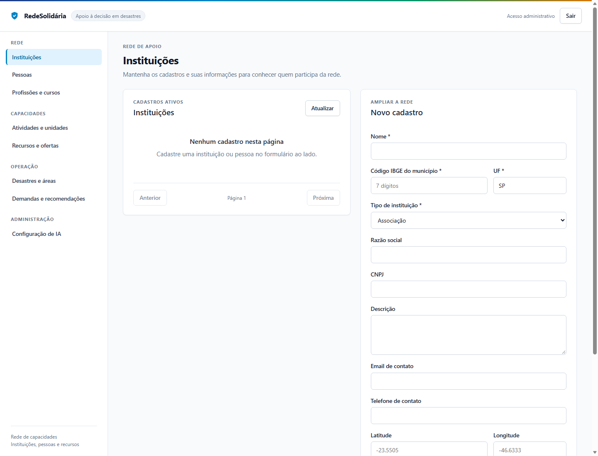

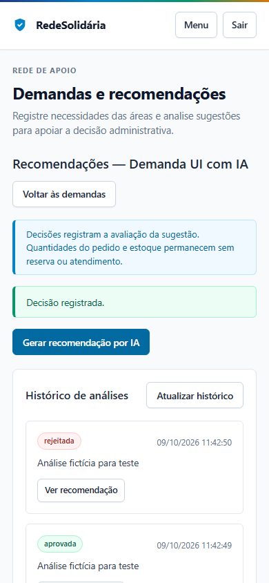

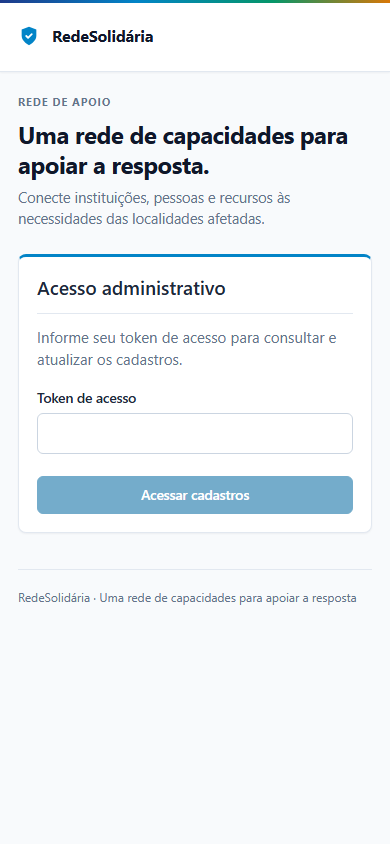

## Reprodução e cenários funcionais

Reproduzir: `npm run build` em `frontend`; depois `.venv\Scripts\python.exe scripts/test_postgres.py --frontend` em `backend`. O script prepara banco/segredo/API temporários, executa também os 103 testes, inicia provedor HTTP fictício local, testa o build no navegador com perfil exclusivo e encerra os recursos criados. Dados e token são apenas de teste; as capturas não representam um servidor de desenvolvimento mantido ativo.

O teste intercepta somente os tiles OpenStreetMap e devolve um fundo SVG local identificado como “Fundo simulado no teste”. Exercita o componente Leaflet real, desenho, validação, formulários e persistência. Não acessa o provedor cartográfico nem comprova disponibilidade ou precisão do fundo externo. Na aplicação, os tiles são solicitados normalmente ao OpenStreetMap, com atribuição visível.

LangChain e LangGraph são reais neste teste; embeddings e sugestões vêm de um provedor HTTP fictício de `backend/tests/provedor_http.py`. Não há chamada a modelo externo, avaliação de qualidade semântica ou medição do indicador acadêmico. API, navegador, provedor e container/volume são encerrados ao final.

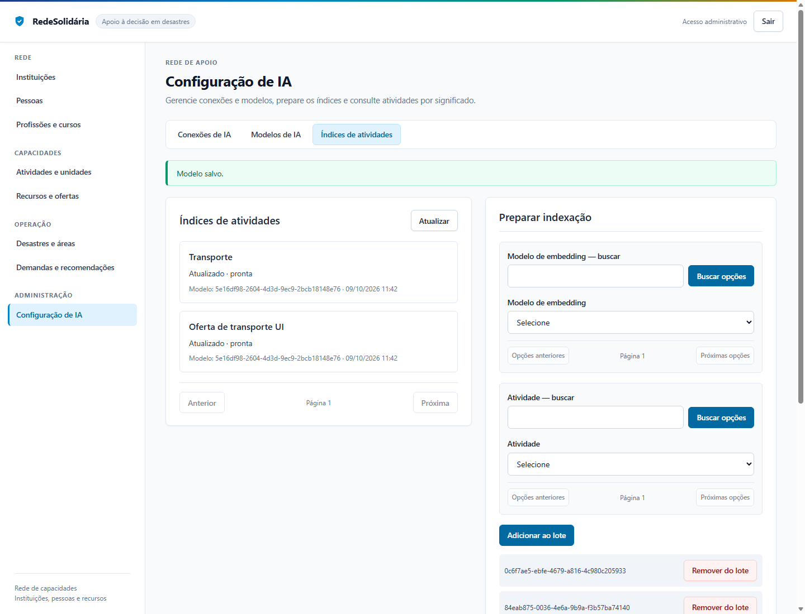

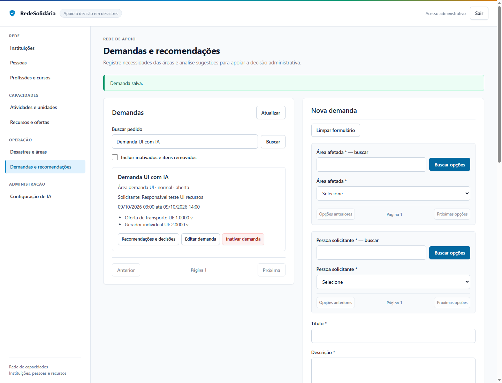

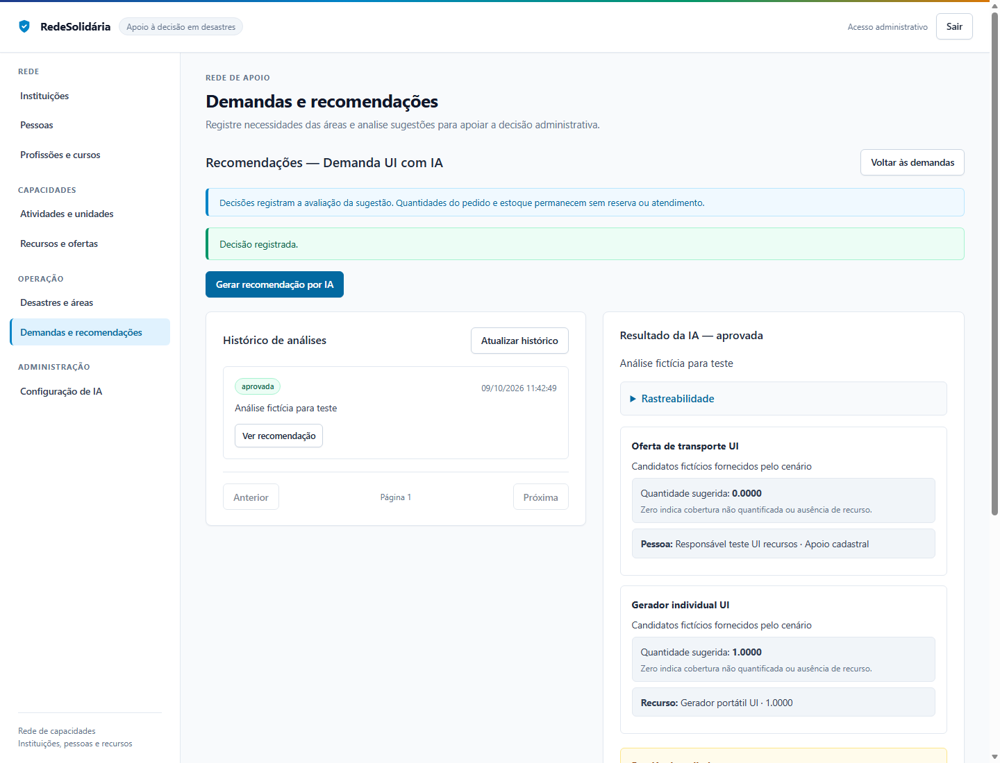

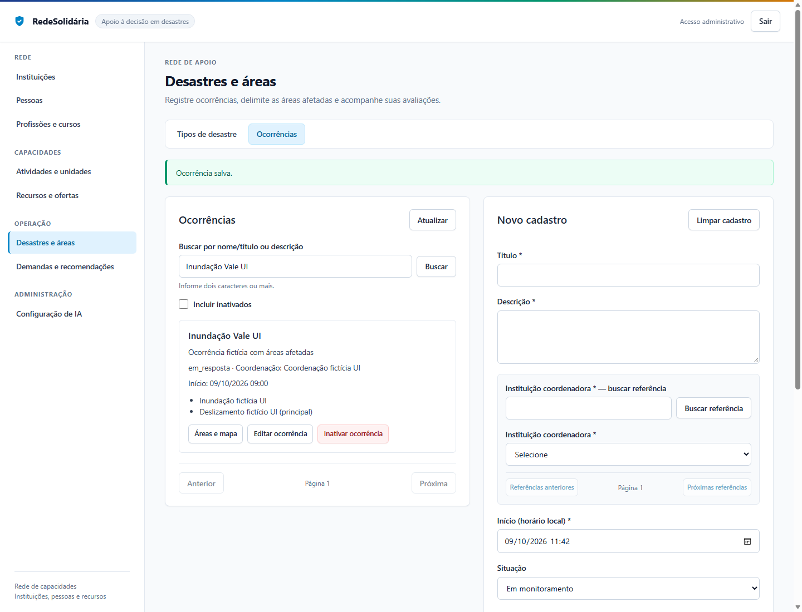

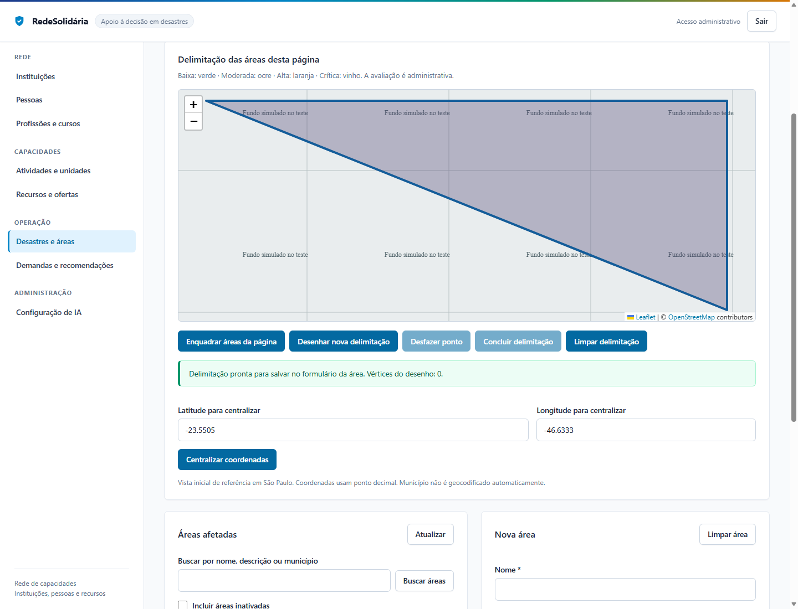

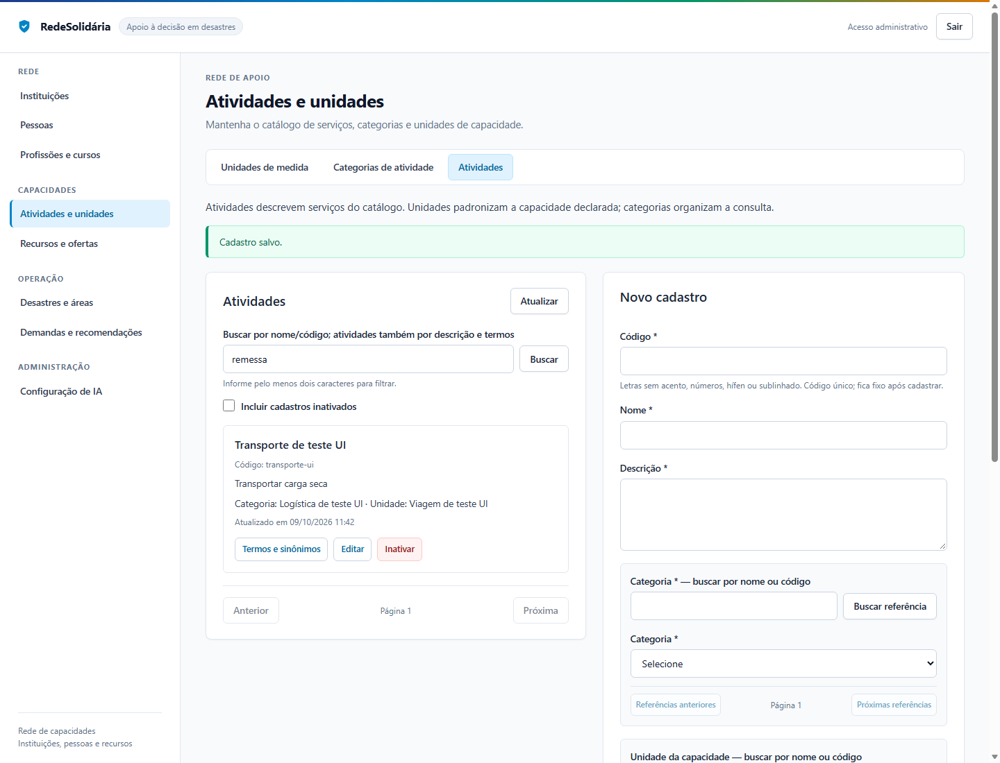

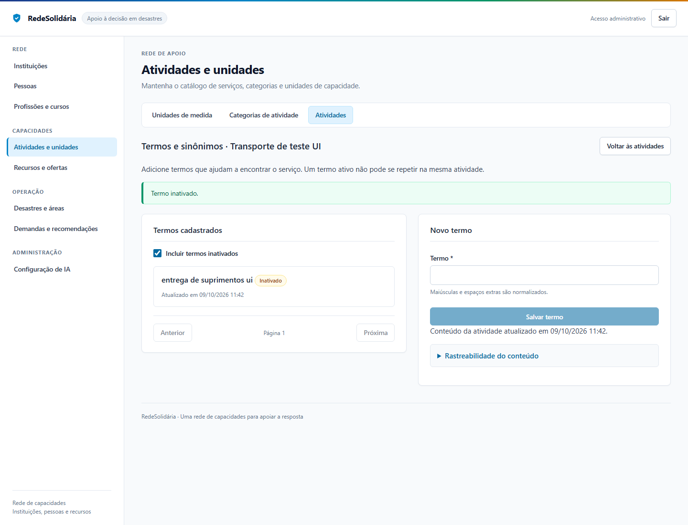

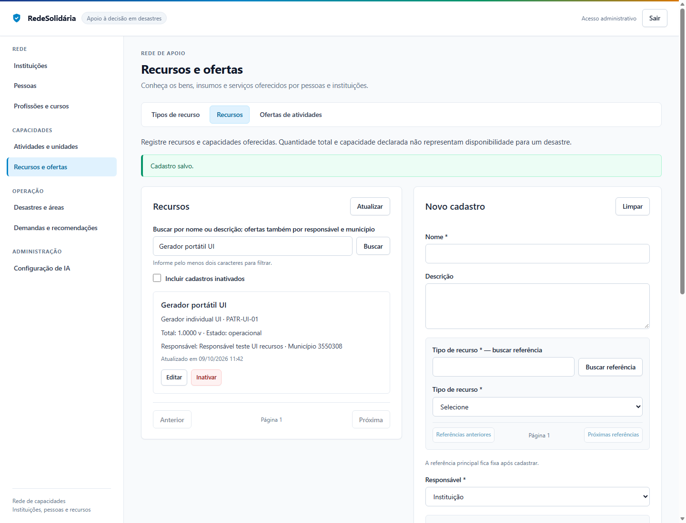

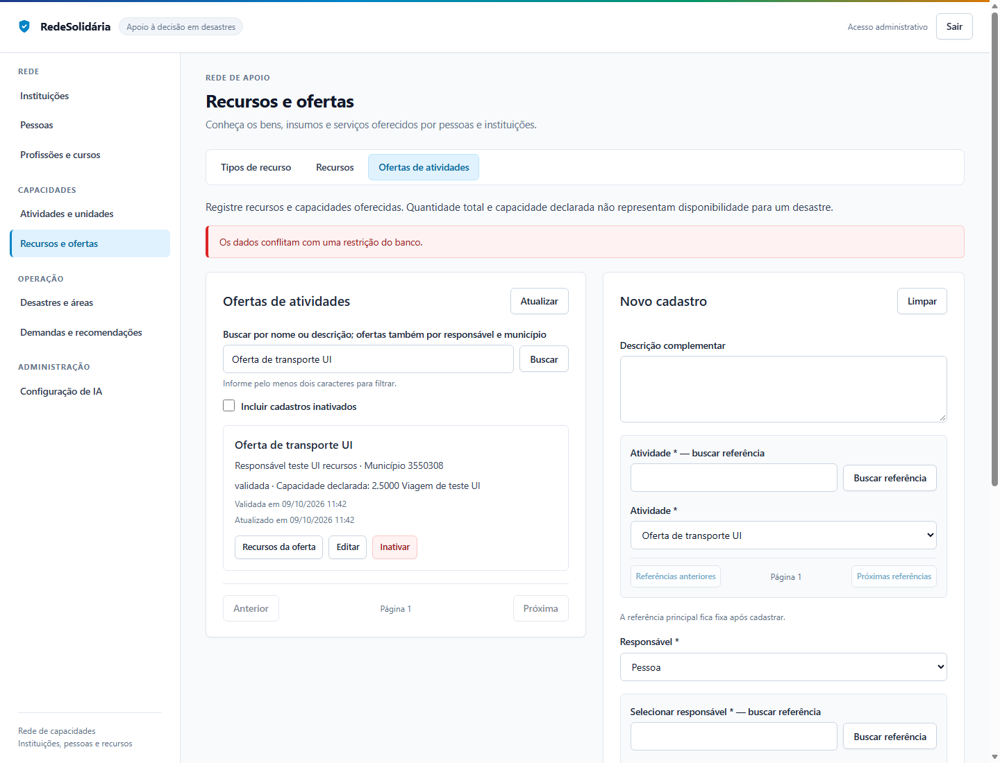

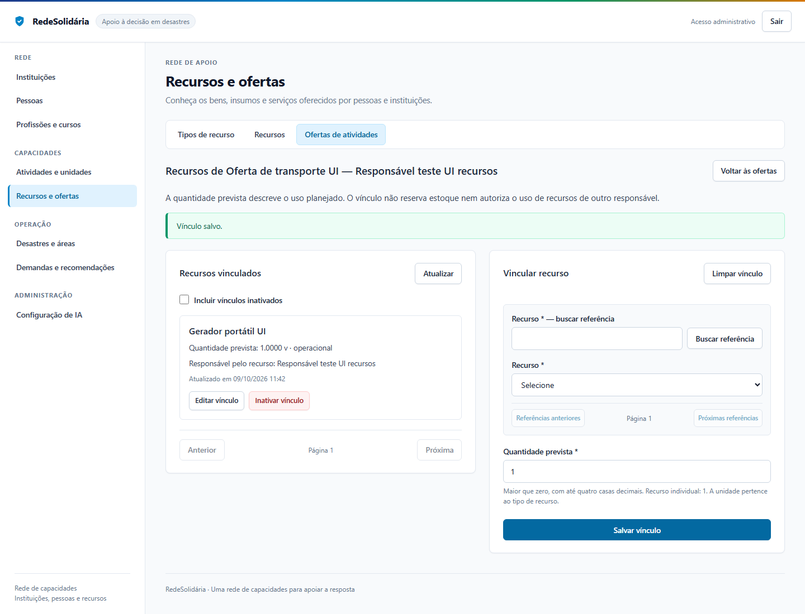
