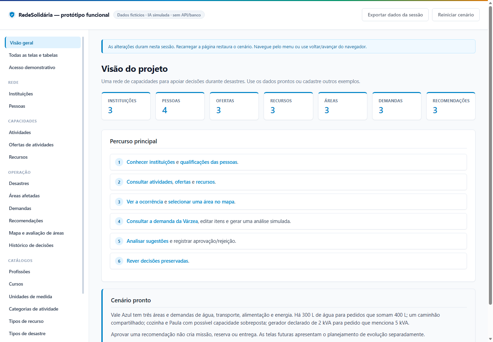
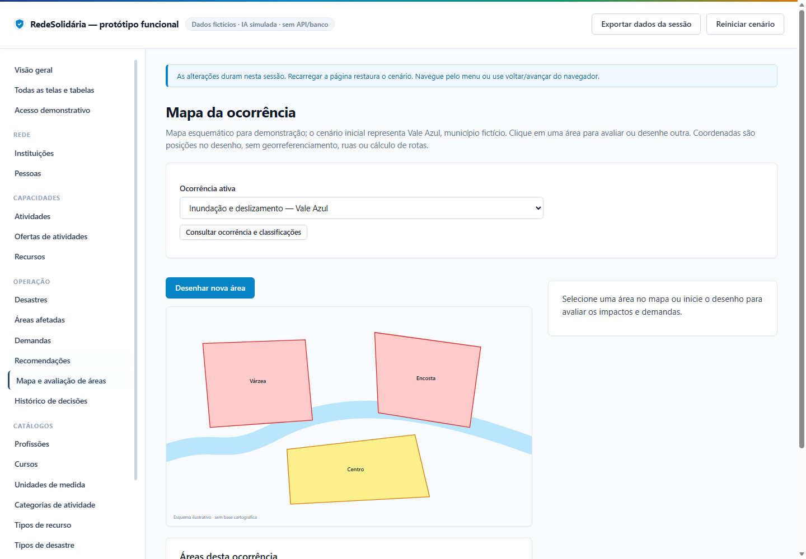
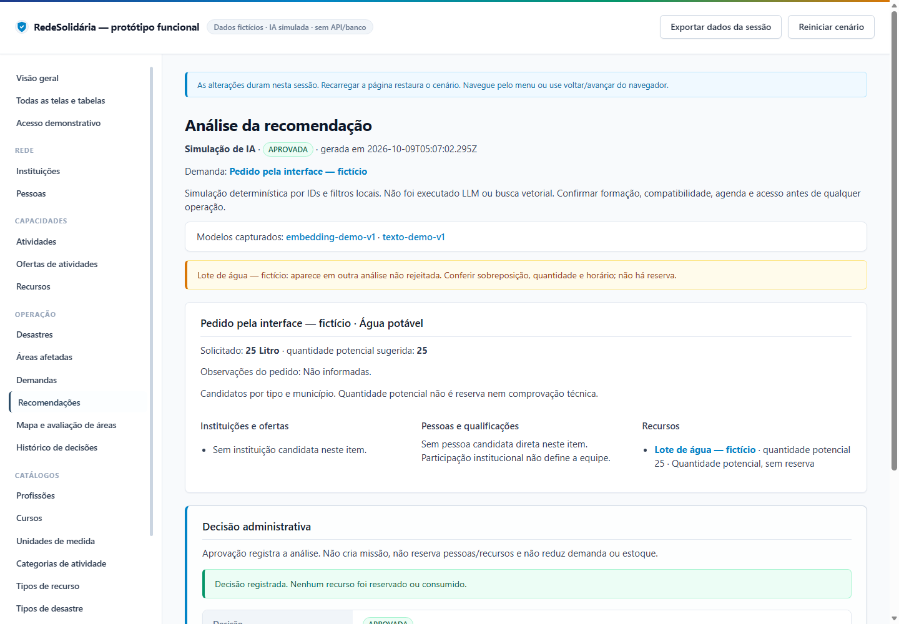

# Verificação do protótipo

Executada em 09/10/2026 com dados fictícios, independente dos testes do backend/frontend integrado.

- **16 verificações de domínio passaram:** cadastros, vínculos, renovações, referências, responsável/unidade, classificação, áreas, hashes/modelos, candidatos/quantidades, decisão/histórico e rascunhos futuros.
- **TypeScript e templates Angular estritos**, além da compilação de produção, passaram.
- **5 cenários em Edge headless passaram:** 50 listas, 39 formulários, 36 detalhes com exemplos e seis telas complementares; voltar/avançar; CRUD institucional; demanda/item; aprovação, nova análise/rejeição; desenho/avaliação de área e histórico.
- Nenhuma exceção da aplicação detectada. Recursos da página vieram do servidor local. Resultado em [navegacao.json](navegacao.json).

Esses testes verificam estados e regras locais. Não medem qualidade de LLM/busca vetorial, aptidão, agenda ou cartografia.

## Reproduzir

Na pasta do protótipo: `npm ci`, `npm test`, `npm run typecheck` e `npm run build`. Iniciar `npm start`; em outro terminal, executar `node scripts/testar-navegacao.mjs`.

O script usa Edge/Chrome com perfil exclusivo em `.teste/` e fecha a instância que iniciou. Se necessário, definir `PROTOTIPO_BROWSER` com o executável. `npm test` prepara os módulos utilizados pelo teste de navegador. Outra execução sobrescreve resultados/capturas.

## Capturas verificadas

Capturas revistas para legibilidade e presença dos controles, sem avaliação estética. A recomendação foi criada pelo teste; recarregar restaura o cenário e não mantém esse registro.

